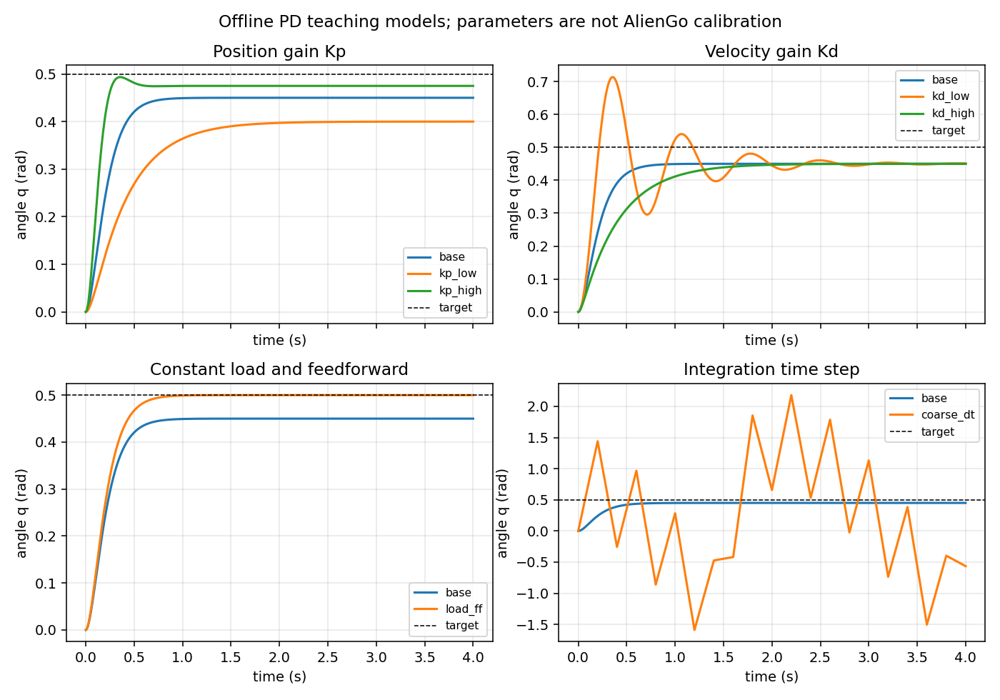

**配对代码：** [pd_lab.py](../examples/lesson03/pd_lab.py) → [ROS 1 关节控制器](../references/unitree_ros/unitree_legged_control/src/joint_controller.cpp)。

# 第 3 课：一个关节怎样追到目标——PD

[上一课：只读 ROS 1 节点](lesson_02_zh.md) · [八课路线](learning_path_zh.md) · [下一课：单腿运动学](lesson_04_zh.md)

上一课得到的是“现在的角度”；这一课研究“有了现在与目标，怎样算出力矩”。完成后，你应能手算 PD 的三项，解释为什么纯 PD 在负载下可能停不到目标，并通过 CSV 判断增益、力矩限幅和步长带来的变化。预计 60 分钟，最后的源码阅读可以另用 20 分钟。

前置知识是会运行一个 Python 脚本，知道 rad、rad/s，以及第 2 课中的变量、函数与列表。本课全部在离线数学模型中完成，Gazebo 可以保持关闭。环境仍沿用项目的 Docker 教学镜像，**不需要安装新的依赖**；基础计算、CSV 与终端表格只用 Python 标准库。

本课所有数值都是刻意选小的教学数，未经 AlienGo 辨识，不能复制到仿真控制器或真机。这里是一个有转动惯量和黏性阻尼的单自由度数学模型，没有连杆碰撞、关节限位、齿隙或多腿接触；模型跑通不会增加 [当前已验收范围](verification.md) 中的真机或小跑能力。

## 1. 先分清“算力矩”与“力矩让关节动”

控制器计算的是：

```text
e = q目标 − q
τ未限幅 = Kp × e + Kd × (dq目标 − dq) + τ前馈
τ实际 = 把 τ未限幅 限制到 [−τ上限, +τ上限]
```

本实验的目标角度固定，所以 `dq目标 = 0`。惯量、阻尼与负载决定这个力矩会产生多大角加速度：

```text
J × ddq = τ实际 − b × dq − τ负载
```

| 变量 / 命令参数 | 物理意义 | 单位 | 默认教学值 |
|---|---|---|---:|
| `q`、`--q0` | 当前角度、初始角度 | rad | 0 |
| `dq`、`--dq0` | 当前角速度、初始角速度 | rad/s | 0 |
| `ddq` | 角加速度，速度每秒改变多少 | rad/s² | 由公式算出 |
| `--target` | 固定目标角度 | rad | 0.5 |
| `--kp` | 位置误差对应的力矩强度 | N·m/rad | 4 |
| `--kd` | 速度误差对应的力矩强度 | N·m·s/rad | 0.8 |
| `--feedforward` | 提前给出的前馈力矩 | N·m | 0 |
| `--torque-limit` | 正负方向共用的力矩绝对值上限 | N·m | 3 |
| `--inertia`，公式里的 `J` | 转动惯量，越大越难改变速度 | kg·m² | 0.05 |
| `--damping`，公式里的 `b` | 被动黏性阻尼，速度越大反向阻力越大 | N·m·s/rad | 0.1 |
| `--load` | 固定负载力矩；正数表示沿负方向作用 | N·m | 0.2 |
| `--dt` | 数值积分步长 | s | 0.002 |
| `--duration` | 模型模拟的时间长度 | s | 4 |

`b` 是被动模型的一部分，`Kd` 是控制器主动计算的速度反馈。两者在本模型里都能抑制运动，但来源不同；`Kd` 项经过执行器力矩限幅，`b` 项是模型内的被动阻力。

可以把位置项想成“离目标越远，拉回去越用力”，把零目标速度时的速度项想成“运动越快，越反向刹车”。只看位置误差无法知道关节是不是正高速冲过目标，所以需要速度反馈。力矩控制还必须考虑动力学、执行器上限与离散实现；正增益不是现实系统无条件稳定的保证。[Modern Robotics：用力矩作输入的单关节 PD](https://modernrobotics.northwestern.edu/nu-gm-book-resource/11-4-motion-control-with-torque-or-force-inputs-part-1-of-3/)

## 2. 在运行前，手算两次

第一题沿用第一课：`q目标=0.5`、`q=0.4 rad`、`dq=0.2 rad/s`、`Kp=20`、`Kd=1`、前馈为零。

```text
位置项 = 20 × (0.5 − 0.4) = +2 N·m
速度项 = 1 × (0 − 0.2)    = −0.2 N·m
总力矩 = +1.8 N·m
```

如果力矩上限为 `1 N·m`，实际只能施加 `+1 N·m`。如果角度已经到 `0.5 rad`，但速度仍为 `+0.2 rad/s`，位置项变成零，速度项仍为负，继续帮助它减速。

第二题使用本课默认值：初始 `q=0`、`dq=0`，没有前馈。**先预测第一步加速度与角度变化方向，再展开核对。**

<details>
<summary>第一步参考计算</summary>

`τ未限幅=4×0.5=2 N·m`，小于上限 3，因此 `τ实际=2`。初始被动阻力 `b×dq=0`，净力矩为 `2−0.2=1.8 N·m`，所以 `ddq=1.8/0.05=36 rad/s²`，沿正方向加速。

程序用半隐式 Euler：先更新速度，再用新速度更新角度。`dt=0.002 s` 时，新速度是 `0.072 rad/s`，新角度是 `0.000144 rad`。这只是一次离散近似，不能理解成加速度在整个 4 秒都保持 36。

</details>

## 3. 先运行默认实验，读懂表格

```bash
cd /home/jack/aliengo_learning
./scripts/ros1_course.sh offline lesson03/pd_lab.py --help
./scripts/ros1_course.sh offline lesson03/pd_lab.py \
  --csv logs/course/lesson03/base.csv
```

路径相对于项目根目录；容器中的 `/work/logs/...` 就是主机上的 `logs/...`，容器退出后 CSV 保留。这里的 `4 s` 是模型时间，程序通常很快算完，不需要真的等待四秒，也不需要启动 ROS 节点。

**先预测：** `q` 最后会不会等于 `0.5 rad`？如果完全到了目标、速度又为零，没有前馈时还剩下多少控制力矩？它能抵消 `0.2 N·m` 的负载吗？

默认结果应接近下面这些行。小数是这份离散模型的实际计算值，不是机器人测量值：

```text
    t(s)      q(rad)    dq(rad/s)   error(rad)    tau(Nm)
   0.000     0.00000      0.00000      0.50000    2.00000
   0.500     0.42068      0.20790      0.07932    0.15096
   1.000     0.44925      0.00567      0.05075    0.19847
   2.000     0.45000      0.00000      0.05000    0.20000
   4.000     0.45000      0.00000      0.05000    0.20000
```

表格的 `tau(Nm)` 是**限幅后控制力矩**，不是减去负载后的净力矩。最后虽然还有 `+0.2 N·m`，它恰好抵消了负载，所以可以速度为零、加速度也接近零。

稳态、未饱和且 `Kp>0` 时，速度与加速度均为零，公式简化为：

```text
Kp × (q目标 − q稳态) + τ前馈 = τ负载
稳态位置误差 = (τ负载 − τ前馈) / Kp
```

本例误差 `0.2/4=0.05 rad`，所以 `q稳态=0.5−0.05=0.45 rad`。**有误差不必然是程序有 bug**；这里需要位置误差产生托住负载的力矩。负载项被刻意简化成恒定值；真实重力矩一般随关节姿态变化，下一课开始建立几何关系后才能继续讨论模型。

## 4. 读关键代码：每一步到底更新什么

打开 [pd_lab.py](../examples/lesson03/pd_lab.py)。开头 `Config` 集中存放上表的值：`@dataclass` 帮你生成这个参数对象，`frozen=True` 表示创建后不直接改成员。现阶段把 `config.kp` 看成“这次实验的 Kp”，无需先掌握装饰器原理。

控制律只有三行：

```python
raw = kp * (target - q) + kd * (0.0 - dq) + feedforward
applied = max(-torque_limit, min(torque_limit, raw))
return raw, applied
```

第一行先算三项相加；第二行先取不超过正上限的值，再保证不低于负上限。`raw=5, limit=3` 时得到 3，`raw=−5` 时得到 −3。第三行同时返回“想要多少”和“实际允许多少”，方便比较饱和。

循环里的关键语句按执行顺序读：

```python
acceleration = (torque - config.damping * dq - config.load) / config.inertia
rows.append({"t_s": t, "q_rad": q, "dq_rad_s": dq, ...})
if step < steps:
    h = min(config.dt, config.duration - t)
    dq = dq + acceleration * h
    q = q + dq * h
```

中间字典用 `...` 省略了 CSV 的其他字段，完整可执行代码在文件中。

| 语句 | 它改变或记录什么 |
|---|---|
| `(...)/config.inertia` | 用当前力矩、速度与负载计算当前角加速度 |
| `rows.append({...})` | 保存当前时刻的一行状态；还没有推进时间 |
| `step < steps` | 最后一行只记录终点，不再多走一步 |
| `h = min(...)` | 最后一步可能不足一个完整 `dt`，保证正好结束在指定时刻 |
| `dq = dq + acceleration * h` | 根据加速度改变速度；赋值会覆盖旧 `dq` |
| `q = q + dq * h` | 用刚更新的新速度改变角度，称为半隐式 Euler |

这是一个教学用数值积分器。对于 `duration=4`、`dt=.002`，共有 2000 个区间、2001 行状态，第一行是 `t=0`。CSV 的力矩与加速度属于该行状态；最后一行的力矩仍可算出，但没有再用它推进另一个区间。

CSV 字段包括 `t_s`、`q_rad`、`dq_rad_s`、`target_rad`、`error_rad`、`tau_raw_Nm`、`tau_applied_Nm`、`ddq_rad_s2` 和 `saturated`。最后一项为 `1` 表示这一行的请求超过力矩上限，`0` 表示没有。表格只抽取几行展示，CSV 保存全部步数。

## 5. 一次只改一件事

每个实验先写预测，再运行。以下所有命令都不会连接 Gazebo 或真机。

### 实验 A：Kp 加倍

预测：相同负载下，最终误差会更大、更小还是不变？初始请求力矩是多少？

```bash
./scripts/ros1_course.sh offline lesson03/pd_lab.py \
  --kp 8 --csv logs/course/lesson03/kp8.csv
```

对照默认 `Kp=4` 的 `base.csv`。末态应接近 `q=.475`、误差 `.025 rad`，符合 `.2/8`。初始请求 `8×.5=4 N·m` 超过 3，因此一开始实际力矩被截成 3；不能把响应当成一个始终未限幅的线性系统。这个例子里提高 Kp 缩小静态误差，但也提高了力矩需求。

### 实验 B：只减小 Kd

预测：目标与负载不变，减小“刹车”会不会让曲线越过最终位置？稳态误差公式中有没有 Kd？

```bash
./scripts/ros1_course.sh offline lesson03/pd_lab.py \
  --kd 0.05 --csv logs/course/lesson03/kd_low.csv
```

默认步长下，这组曲线最高约 `0.71349 rad`，明显越过 `0.5 rad` 目标，随后振荡衰减；4 s 末态约 `0.45091 rad`，已经接近同一个 `0.45 rad` 平衡位置。`Kd` 主要改变这个实验的过渡过程，不能消除静止时由固定负载产生的误差。

### 实验 C：前馈抵消已知负载

预测：把前馈设成 `0.2 N·m` 后，误差公式给出多少？稳定在目标时，实际力矩是 0 还是 0.2？

```bash
./scripts/ros1_course.sh offline lesson03/pd_lab.py \
  --feedforward 0.2 --csv logs/course/lesson03/load_ff.csv
```

末态应接近 `q=.5 rad`，而控制力矩仍为 `.2 N·m`。前馈提前提供负载所需力矩，位置项就不需要靠持续误差来提供它。这里能精确抵消，是因为负载固定且已知；错误的前馈也会造成偏差，不应把这个常数当成真机所有姿态的补偿。

### 实验 D：执行器力矩不够

预测：如果上限只有 `0.1 N·m`，而负载为 `0.2 N·m`，即使误差很大，实际力矩最多是多少？能否静止托住负载？

```bash
./scripts/ros1_course.sh offline lesson03/pd_lab.py \
  --torque-limit 0.1 --csv logs/course/lesson03/limited.csv
```

本模型里角度会向负方向走，4 s 末态约 `−3.50216 rad`。实际最大正向力矩仍只有 `.1 N·m`，连静态负载都抵消不了。程序没有机械关节限位，所以会出现真实机器人不能直接照搬的角度；这个实验展示的是力矩不足的数学后果。增大 Kp 只会让 `tau_raw_Nm` 更大，不能突破 `tau_applied_Nm` 的上限。

### 实验 E：把时间步长放大 100 倍

预测：控制器参数没变，只把计算更新间隔从 `.002 s` 改成 `.2 s`，结果是否一定一样？

```bash
./scripts/ros1_course.sh offline lesson03/pd_lab.py \
  --dt 0.2 --csv logs/course/lesson03/coarse_dt.csv
```

这次结果会与基准差很多：峰值约 `2.18006 rad`、末态约 `−0.56463 rad`，许多区间打到力矩上限。离散步长过大既降低积分精度，也改变离散闭环的行为；不能据此认定连续系统或真实关节会照着这条粗糙曲线运动。再运行 `--dt .001`，应与 `.002` 的基准更接近；步长收敛比较能帮助区分数值误差与所研究的物理现象。

<details>
<summary>五个实验的预测讲评</summary>

A：误差从 `.05` 减到 `.025 rad`，但起始请求从 2 增到 4 N·m，触发限幅。

B：阻尼反馈减弱，过冲和振荡增大；静止后速度项为零，固定负载仍须由位置项或前馈支撑。

C：已知固定负载由前馈抵消，稳态误差趋零，执行器仍持续输出 `.2 N·m`。

D：上限低于负载，当前方向的静态平衡不可能实现；想要的力矩与能施加的力矩必须分开记录。

E：计算与更新步长也是模型的一部分。改变步长后的差异需要结合离散算法解释，不能拿粗步长造成的数值振荡去“证明增益不好”。

</details>

## 6. 用一张对照表整理结果，可选画图

想一次重做这些对照时运行：

```bash
./scripts/ros1_course.sh offline lesson03/pd_lab.py --suite \
  --csv logs/course/lesson03/pd.csv
```

程序会输出 `pd_base.csv`、`pd_kp_low.csv` 等八份文件，以及以下汇总；每组相对基准只更改名字所示的那一个参数。`load_ff` 把前馈改成负载；`limited` 把力矩上限除以 30；`coarse_dt` 把步长固定为 `.2 s`。其他对照将 Kp 减半/加倍、Kd 除以 16/乘以 2。

| 实验 | 末态 q / rad | 末态误差 / rad | 峰值 q / rad | 说明 |
|---|---:|---:|---:|---|
| `base` | .45000 | .05000 | .45000 | 默认基准 |
| `kp_low` | .39998 | .10002 | .39998 | Kp=2 |
| `kp_high` | .47500 | .02500 | .49353 | Kp=8，有短暂饱和 |
| `kd_low` | .45091 | .04909 | .71349 | Kd=.05，过冲明显 |
| `kd_high` | .44998 | .05002 | .44998 | Kd=1.6，接近终点较慢 |
| `load_ff` | .50000 | .00000 | .50000 | 前馈=.2 |
| `limited` | −3.50216 | 4.00216 | .00000 | 上限=.1，无法支撑负载 |
| `coarse_dt` | −.56463 | 1.06463 | 2.18006 | dt=.2，离散结果失真 |

终端中的 `saturated%` 是饱和区间占总区间的比例，最后一条只记录状态、不计作一个额外区间。当时长不是步长整数倍时，最后区间较短，这个比例按区间数计，不是精确的时间占比。

画图是可选项。主机已备有 matplotlib 时，可直接用主机 Python 运行同一份纯离线脚本；**无需给 Docker 安装绘图库**：

```bash
python3 examples/lesson03/pd_lab.py --suite \
  --csv logs/course/lesson03/plot_pd.csv \
  --plot logs/course/lesson03/pd_compare.png
```

PNG 上半部分是角度，下半部分是限幅后的力矩，虚线为目标角度。它是保存到文件的图片，不会弹出窗口。即使 matplotlib 不可用，前面的 CSV 与终端表格也足以完成验收。[Python 标准库 CSV 文档](https://docs.python.org/3/library/csv.html)、[matplotlib 的 savefig 文档](https://matplotlib.org/stable/api/_as_gen/matplotlib.pyplot.savefig.html)

下面将四类对照分面展示，使用本节实验的CSV数据。虚线为目标角度；蓝线为同一基准模型。右下图让你直观看到粗步长造成的数值失真，左下图展示已知负载的前馈补偿。



## 7. 回到仿真工程：找到相同变量

[ROS 1 关节控制器](../references/unitree_ros/unitree_legged_control/src/joint_controller.cpp) 接收 `q`、`dq`、`Kp`、`Kd`、`tau`，将它们放入仿真关节控制计算。可从其 `update()` 和对应控制工具追踪反馈与力矩。

仿真模型的 effort 限制、控制器计算和物理引擎的执行是不同环节，不能仅凭某处存在限制数字就认为全链路或实机保护已验证。这里不向关节发送大力矩测试。

## 8. 失败时怎样缩小问题

| 现象 | 怎么检查 |
|---|---|
| 程序报告 `inertia需要大于0` | 惯量不能为零；检查是不是把 `.05` 输成了 `0` |
| 报步长、时长或非有限数错误 | `dt`、时长、力矩上限必须为正有限数；增益与被动阻尼不能为负 |
| 报“最多200000步” | `duration/dt` 过大；缩短时长或适当增大步长，先完成小实验 |
| 角度没有到目标 | 查末态速度、固定负载、前馈和误差公式；不要先认定增益或程序错误 |
| 出现很大振荡、数值发散 | 先恢复默认参数，缩小步长，查看 `tau_raw` 与 `tau_applied` 是否饱和 |
| 提示没有 matplotlib | 省略 `--plot`，继续读表格和 CSV；或使用已有绘图库的主机 Python |
| CSV 写入失败 | 看完整路径和权限；目录会自动创建，换到可写的项目 `logs/` 路径 |

想检查课程代码本身，可在主机运行这个只用标准库的单课测试命令，不需要启动仿真：

```bash
python3 -m unittest discover -s tests -p 'test_lesson02_03.py' -v
```

测试包含手算一步的动力学、对称力矩限幅、负载与前馈的稳态结果、缺字段和数组重排。它们验证的是这份教材程序，不代表真机关节动力学已经通过测试。

## 本课验收：三个问题

1. `q目标=.5`、`q=.4 rad`、`dq=.2 rad/s`、`Kp=20`、`Kd=1`、前馈为零时，未限幅力矩是多少？如果已经到目标但还正向运动，速度项为什么仍存在？
2. 默认负载 `.2 N·m`、`Kp=4`，为什么末态停在 `.45 rad`？前馈改成 `.2` 后为什么能到 `.5`？如果力矩上限只有 `.1`，前馈还能凭空托住负载吗？
3. 相同 Kp/Kd 下，为什么改惯量、阻尼、步长或力矩上限会改变结果？你在上游源码看到了哪一处 PD 计算，又有哪些限幅结论还没有证据？

<details>
<summary>验收参考答案与讲评：先自己回答再展开</summary>

1. `2−.2=1.8 N·m`。到达目标只让位置误差为零；目标速度为零而实际速度仍为正，速度误差为负，Kd 项提供反向力矩。
2. 未饱和稳态需要 PD 托住负载，误差 `.2/4=.05 rad`，所以 `.5−.05=.45`。相同负载前馈后，零误差也能持续输出 `.2 N·m`。上限 `.1` 时前馈也经过限幅，实际仍不够，不能实现这个静态平衡。
3. 惯量决定净力矩产生的加速度，阻尼决定被动阻力；离散步长改变积分和更新，限幅改变实际可用力矩。源码中的关节控制器接收目标角、速度、增益和前馈力矩；需要继续核查完整路径中的限幅。模型声明限制与完整仿真/真机链路实际执行保护，是需要分别验证的证据。

真机关节还多了多关节耦合、真实摩擦、延迟、测量噪声、固件模式和负载变化。通过 toy 的意义，是学会分清变量与实验条件，并能提出下一步检查；不能从这张离线表直接选定真机增益。

</details>

保存一份基准 CSV、一个你改变参数的对照，以及自己的解释。下一课 [从角度到脚的位置](lesson_04_zh.md) 会把这里的标量 `q` 与实际腿的几何关系连接起来。
