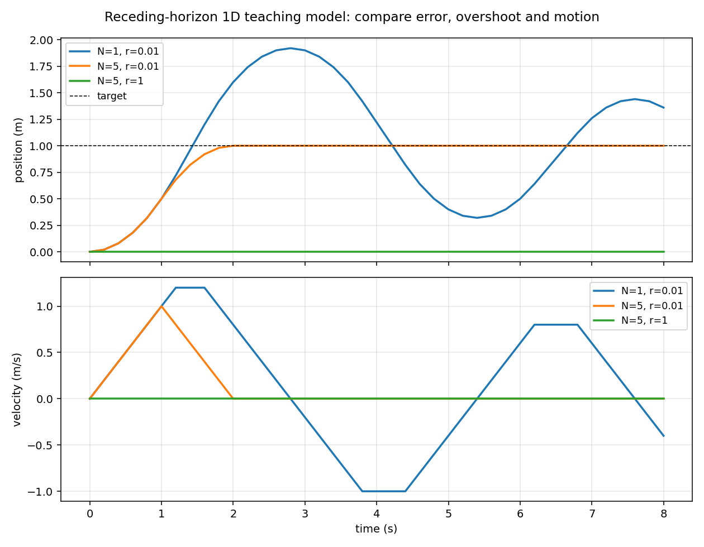

**配对代码：** [static_forces.py](../examples/lesson07/static_forces.py)、[mpc_1d.py](../examples/lesson07/mpc_1d.py) → [BalanceCtrl.cpp](../references/unitree_guide/unitree_guide/src/control/BalanceCtrl.cpp)。

# 第 7 课：站稳需要多少力——从接触力到 MPC

[上一课：状态估计](lesson_06_zh.md) · [学习路线](learning_path_zh.md) · [下一课：SDK 桥接与离线验收](lesson_08_zh.md)

建议 60 分钟，也可以把受力和 MPC 分成两次。前置：知道 PD 输出力矩；理解足端雅可比把关节速度变成足端速度；能区分世界系与机身系、传感器与估计。

本课做两个真正能运行的离线程序：算支撑力、摩擦与力矩符号；用一维小车的有限时域搜索体验预测控制。质量20 kg、示例雅可比、摩擦系数和代价权重都是教学数字，不是 AlienGo 标定或调参建议。全课无需切换仿真状态，也不安装 OCS2。

## 1. 先画“地面对机器人”的力

世界系 W 取 x 向前、y 向左、z 向上。定义 `F_i` 为第 i 个接触点上**地面对机器人**的力，单位 N；机器人施于地面的力是 `−F_i`。两者分属不同受力对象，不能在机器人的受力图上再画一份 `−F_i` 抵消它。

忽略空气阻力、其他外力，机身质心的平动方程为：

```text
m a_COM = Σ F_i + m g_W
g_W = (0, 0, −9.81) m/s²
```

静止时 `a_COM=0`，所以 `ΣF_iz=mg`，水平方向合力为零。还需要满足绕质心的力矩平衡：

```text
Σ r_i × F_i = 0
```

`r_i` 是质心指向接触点的向量，单位 m，与 `F_i` 用同一组世界轴表达。只让四个竖直力的和等于重量，并不能保证不翻倒。

先取一个质心居中、四脚对称、地面水平的20 kg教学物体。重量 `20×9.81=196.2 N`，四脚均分时每脚 `49.05 N`。重心前移后通常不能继续均分；只有两脚支撑时，还要看质心投影是否位于可支撑的位置。`equal_support_forces()` 只做对称均分计算，不求解任意脚位的力矩平衡。

**预测：** 在上述对称假设不变时，质量加倍，每脚竖直支撑力会怎样变化？如果一只脚离地，直接将重量除以3就能保证稳定吗？

## 2. 为什么摩擦限制水平加速度

单脚的理想库仑摩擦锥可写成：

```text
F_z ≥ 0
sqrt(F_x² + F_y²) ≤ μ F_z
```

地面可以推脚，不能凭空向下拉住脚；水平合力也不能无限大。μ 是无单位的摩擦系数。

取 `μ=0.5`，每脚 `F_z=49.05 N`，水平力大小最多约 `24.525 N`。若四脚均分水平力、机身高度恒定且无其他竖直加速度，总竖直支撑为 `mg`，因此整体满足 `|a水平|≤μg=4.905 m/s²`。这只是此简化假设下的力学上界，实际还受姿态力矩、足位、关节力矩、接触和控制带宽限制。

例如每脚 `(F_x,F_y,F_z)=(20,20,49.05) N`，分别比较 x、y 都似乎没超 `24.525 N`，但水平向量大小 `√800≈28.28 N`，已经超出圆锥。不能把两个方向分别合法当成整体合法。

运行支撑力与摩擦实验：

```bash
cd /home/jack/aliengo_learning
./scripts/ros1_course.sh offline lesson07/static_forces.py --mass 20 --contacts 4 --mu 0.5 --ax 1
./scripts/ros1_course.sh offline lesson07/static_forces.py --mass 20 --contacts 4 --mu 0.5 --ax 6
```

**动手：** 保持质量与接触数不变，只改变 `--ax`。**预期：** 两次竖直力均为每脚 `49.05 N`，水平力分别为 `5 N`、`30 N`；第一次摩擦检查为 `True`，第二次为 `False`。程序会展示约束失败，不会偷偷把6改成可行值。它不向机器人发送这些力。

## 3. 雅可比转置中的正负号

足端微小位移满足 `δp=Jδq`，J 的行是足端 x/y/z，列是各关节，单位 m/rad。外界地面对脚的力做虚功：

```text
δW_external = F_groundᵀ δp = (JᵀF_ground)ᵀ δq
```

所以外力对应的广义关节力是 `JᵀF_ground`。在**基座固定、腿质量忽略、静止、无其他关节重力/惯性项**的教学模型里，要用执行器抵消这个外力：

```text
τ_actuator + JᵀF_ground = 0
τ_actuator = −JᵀF_ground
```

若另定义 `f_robot_on_ground=−F_ground`，同一关系才可写成 `τ_actuator=Jᵀf_robot_on_ground`。看到 `τ=Jᵀf`，先问清 f 的方向和受力对象。实际浮动机身动力学还包含质量矩阵、速度项、重力、接触雅可比和执行器选择矩阵，不能用固定基座玩具式子包办整机控制。

手算这个两关节、三行的局部雅可比：

```text
J = [ 0.2   0.0 ] m/rad      F_ground = [ 0 ] N
    [ 0.0   0.0 ]                       [ 0 ]
    [ 0.1  −0.2 ]                       [50 ]

JᵀF_ground = (5, −10) N·m
τ_actuator = (−5, +10) N·m
```

若再加入 `F_x=10 N`，第一关节需要抵消的外力矩增加 `2 N·m`，执行器变成 `(-7,+10) N·m`。两个关节力矩符号不同来自雅可比列的物理方向。

[static_forces.py](../examples/lesson07/static_forces.py) 中 `compensation_torque()` 的核心就是对每一列点乘，并在外面取负号：

```python
-sum(rows[axis][joint] * force[axis] for axis in range(3))
```

默认脚本使用上面的示例 J，但力为第一段实验算出的 `(5,0,49.05) N`，所以会打印约 `(-5.905,+9.81) N·m`。这些是局部数学示例，不能直接填入 AlienGo 的12电机命令。

## 4. Guide：优化当前接触力，不等于在跑 MPC

[BalanceCtrl.cpp](../references/unitree_guide/unitree_guide/src/control/BalanceCtrl.cpp) 按计划接触和动力学分配期望足端力；结合 [State_Trotting.cpp](../references/unitree_guide/unitree_guide/src/FSM/State_Trotting.cpp) 追踪力坐标与雅可比。当前力分配不自动等于多步预测 MPC；符号、坐标和接触假设必须一起核对。

## 5. 让一维小车替我们理解预测

现在暂时离开四足模型。取一维位置 x，单位 m；速度 v，单位 m/s；控制动作 a，单位 m/s²。每一步内加速度恒定，采样周期 `dt=0.2 s`：

```text
x_(k+1) = x_k + dt v_k + ½dt² a_k
v_(k+1) = v_k + dt a_k
```

例如 `x=1 m`、`v=2 m/s`、`a=−1 m/s²`，经过0.5秒后，`x=1+1−0.125=1.875 m`，`v=1.5 m/s`。速度还没降到零，位置仍在增加。

目标从 `(x,v)=(0,0)` 走到 `x_target=1 m`，候选动作只有 `{-1,0,+1} m/s²`。要求每一步预测速度 `|v|≤2 m/s`。给一串未来动作打分：

```text
Cost = Σ_(j=1..N) [ (x_(k+j) − 1)² + r a_(k+j−1)² ]
```

第一项希望位置靠近目标，第二项惩罚动作强度。本例不另设速度代价、终端约束和终端代价；因此它可能出现振荡或停滞，正好用来观察设计选择的后果。这里权重带有把位置误差与加速度成本换算到统一数值尺度的作用，单位和量纲不能无条件照搬到真机代价函数。

`N=5` 表示向前看 `1 s`；每个候选动作有3种，总共检查 `3⁵=243` 条动作序列。枚举所有序列，逐步预测，排除违反速度约束的序列，选择代价最小者。这是在给定离散动作集合里的穷举最优，不是连续动作优化器，也不是仓库里的四足 MPC。

**手算预测：** 设当前 `x=0.8 m`、`v=1 m/s`。只看下一步时，`a=0` 正好预测到1米，代价为0；但下一步速度仍为1 m/s。看得更远就会看到继续向前冲，需要更早刹车。本例 `N=5,r=0.01` 会选择先 `a=−1`。

## 6. 滚动时域：算五步，只执行第一步

[mpc_1d.py](../examples/lesson07/mpc_1d.py) 有三个主要函数：

1. `predict_step()` 对应双积分器公式；先检查有限数值和正步长。
2. `choose_action()` 枚举动作序列，保存最低代价的计划、所有预测状态和第一步动作。
3. `simulate()` 只取 `plan['action']` 推进一步，然后用新的状态重新求解；未把整个旧计划一口气执行。

这是“模型预测”和“滚动”各自发生的位置。真实系统下一步读到的是新估计状态，本例为了分清概念，先让被控对象与预测器使用同一个精确小模型。

运行三个配置的对比：

```bash
cd /home/jack/aliengo_learning
./scripts/ros1_course.sh offline lesson07/mpc_1d.py --compare --steps 40 --csv logs/course/lesson07_mpc_compare.csv
```

**先预测：** 把 N 从1改成5后，超调会怎样变？保持 N=5、把动作成本从0.01加到1后，是否一定更平稳且仍能到达目标？然后记录输出。

在默认 `dt=0.2 s`、40步、同一离散模型下，本地离线实测如下，单位已写在列名中：

| N / 动作成本 r | 最终绝对位置误差 m | 最大超调 m | 最大速度 m/s | Σa²dt |
|---|---:|---:|---:|---:|
| 1 / 0.01 | 0.360000 | 0.920000 | 1.200000 | 6.400000 |
| 5 / 0.01 | 0.000000 | 0.000000 | 1.000000 | 2.000000 |
| 5 / 1 | 1.000000 | 0.000000 | 0.000000 | 0.000000 |

下图由本次对照实验的CSV绘制：上图看位置与目标，下图看速度。绿色曲线始终停在原点，蓝色曲线明显越过目标，橙色曲线在这个特定教学配置下接近目标并停下。



最后一行完全没动。有限预测窗内，离散动作带来的近期改善不足以支付大动作成本，零动作一直胜出。“超调为零”在这里不是成功跟踪，必须同时看误差与动作。这个例子也表明，延长时域和改权重并非随意变大就更好。

CSV 每个配置有41行数据（初始时刻+40步），总共123行数据加表头；记录 `time_s`、`position_m`、`velocity_m_s`、`applied_acceleration_m_s2`。初始动作记0；其他行的动作是**到达该行状态的前一个时间区间**实际施加的加速度。可按 `horizon` 与 `action_cost` 筛选，再比较位置随时间的曲线。

**动手：** 一次只改变一个条件，运行自己的对比：

```bash
./scripts/ros1_course.sh offline lesson07/mpc_1d.py --horizon 3 --action-cost 0.01 --steps 40 --csv logs/course/lesson07_mpc_h3.csv
./scripts/ros1_course.sh offline lesson07/mpc_1d.py --horizon 5 --action-cost 0.1 --steps 40 --csv logs/course/lesson07_mpc_r01.csv
```

**排错：** `horizon` 限1～8，避免指数枚举突然变慢；`dt` 必须正且有限；权重不可为负。所有候选违反约束时会明确报错；不将约束悄悄删除。穷举在这里很小，未来的高维四足问题不能照此规模直接扩展。

## 7. 四足 MPC 还多了什么

真实四足预测还需要机身状态、动力学、接触切换、摩擦和执行器约束。本课的一维离线示例不代表已在机器人上运行 MPC。

## 8. 验收与讲评

可重复的边界测试覆盖力平衡、二维水平摩擦合力、力矩符号、积分步长、预测约束和滚动时域行为：

```bash
python3 -m unittest discover -s tests -p test_lesson06_07.py -v
```

请先独立回答三个问题：

1. 20 kg物体在对称四脚静止支撑下，每脚竖直力多少？若质心移到一侧，为何“总竖直力等于重量”还不够？
2. 在本课 J 和 `(0,0,50) N` 的地面对机器人外力下，抵消它的执行器力矩是多少？为什么 Guide 在 `calF()` 后取负号，再做坐标变换？
3. 一维 MPC 的模型、时域、目标和约束分别写在哪？为什么 N=5、r=1 的零超调不能说明控制效果好？请附自己的 N=3 或 r=0.1 的运行指标与解释。

<details>
<summary>讲评与继续条件</summary>

1. 每脚49.05 N；还需水平合力及绕质心力矩平衡，接触力必须可实现，质心移动会改变分配。
2. `(-5,+10) N·m`。本课定义 F 为外界对机器人的力，固定基座忽略重力的执行器补偿为 `−JᵀF`；Guide 支撑分支将地面对机身的优化力取反，再转为与腿雅可比一致的轴。
3. `predict_step()` 是模型，horizon 与 dt 决定预见多久，平方误差与动作成本是目标，动作集合及速度上限是约束。大权重配置完全不动，最终误差1米；需看多个指标。能解释计算与限制，再进入 SDK 字段和离线故障验收。

</details>

[上一课：状态估计](lesson_06_zh.md) · [下一课：为真机准备接口](lesson_08_zh.md)
