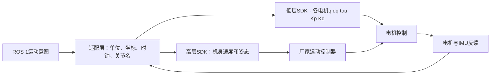

**配对代码（按顺序阅读）：** 教学实验（本课程编写）[offline_bridge.py](../examples/lesson08/offline_bridge.py) → SDK源码（宇树官方v3.3.1，仅阅读）[comm.h](../references/unitree_legged_sdk/include/unitree_legged_sdk/comm.h) → [quadruped.h](../references/unitree_legged_sdk/include/unitree_legged_sdk/quadruped.h) → [example_position.cpp](../references/unitree_legged_sdk/examples/example_position.cpp)。

# 第8课：把仿真知识带到SDK接口——先完成离线验收

[上一课：受力与预测控制](lesson_07_zh.md) · [下一课：强化学习入门](lesson_09_zh.md) · [课程目录](course_index_zh.md) · [学习路线](learning_path_zh.md)

建议分两次学习，每次45～60分钟。前置是能解释第2课的名字映射、第3课的PD字段，以及第6课的时间戳与坐标系。目标是读懂SDK数据结构，写出可以解释的输入检查，列清进入真机开发前仍缺少的设备证据。

本课的程序只生成检查结果和JSON记录；它没有SDK发送器，也不会构造可发送的 `LowCmd` 报文。所有实验通过无网络容器运行。当前还没有你的实际固件与电机映射证据，所以接口开发先到离线数据这一层。

## 1. 先画清两条控制路线



高层路线中，你表达“希望向前多快、怎样转弯”，厂家控制器负责相应的步态与电机目标。低层路线中，你需要自己的算法生成每个关节的目标，并处理反馈、时序和异常。两条路线的职责不同；实际设备开放哪条路线、怎样切换，取决于对应固件和开发接口。

现有 ROS 1 仿真使用 Guide 与仿真关节控制器。把仿真接口替换成 SDK，需要明确适配协议字段、单位、关节名和时钟。

**先预测：** 相同的数字在两个状态机中是否一定表示同一个动作？仿真键盘的 `2` 用于请求站立；SDK v3.3.1 的 `HighCmd.mode=2` 定义为速度行走。适配层必须按语义转换，不能直接复制数字。[SDK comm.h](../references/unitree_legged_sdk/include/unitree_legged_sdk/comm.h)

## 2. 读固定版本，认清字段

本地SDK固定为 `v3.3.1`，commit `20929b54030c0d8ca4e7ac49ec2a02c447cb9fcd`。它的README声明支持AlienGo与A1；这只是选择参考代码的依据，实际兼容还需对应设备固件。[官方固定版本](https://github.com/unitreerobotics/unitree_legged_sdk/tree/v3.3.1)

先打开以下三个文件：

| 文件 | 这次找什么 |
|---|---|
| [quadruped.h](../references/unitree_legged_sdk/include/unitree_legged_sdk/quadruped.h) | `LeggedType::Aliengo` 与12个关节索引 |
| [comm.h](../references/unitree_legged_sdk/include/unitree_legged_sdk/comm.h) | `MotorCmd`、`MotorState`、`LowCmd`、`LowState`、`HighCmd` |
| [aliengo_const.h](../references/unitree_legged_sdk/include/unitree_legged_sdk/aliengo_const.h) | 角度限值常量和单位 |

`MotorCmd` 的五个常用浮点字段与第3课对应：

| SDK字段 | 物理意义 | 单位 |
|---|---|---|
| `q` | 目标关节角 | rad |
| `dq` | 目标角速度 | rad/s |
| `tau` | 前馈力矩目标 | N·m |
| `Kp` | 位置刚度 | N·m/rad |
| `Kd` | 速度阻尼系数 | N·m/(rad/s) |

`mode` 是电机工作模式，`levelFlag` 是通信层级标志，`HighCmd.mode` 又是高层运动模式。它们需要分别查阅对应接口。该tag中的 `HIGHLEVEL=0x00`、`LOWLEVEL=0xff` 是这一版的常量；初始化、结构体填充和CRC应由匹配版本的SDK接口处理。

反馈中，`MotorState.q/dq` 是角度与角速度，`tauEst` 是估计输出力矩；它的名字没有承诺直接力矩传感器测量。`footForce` 是 `int16` 传感器读数，当前头文件未给出标定比例，使用前还需明确量纲。SDK的IMU四元数排列为 **w,x,y,z**，ROS `sensor_msgs/Imu` 字段为 **x,y,z,w**。

**小算例：** SDK四元数数组 `[1,0,0,0]` 表示单位姿态。转成ROS字段应得到 `x=0,y=0,z=0,w=1`。直接按下标拷贝会改变含义。

## 3. 12个关节怎样落到索引上

这是当前 `quadruped.h` 的命名索引对应关系：

| SDK索引 | SDK常量 | 本课程关节名 |
|---:|---|---|
| 0 | `FR_0` | `FR_hip_joint` |
| 1 | `FR_1` | `FR_thigh_joint` |
| 2 | `FR_2` | `FR_calf_joint` |
| 3 | `FL_0` | `FL_hip_joint` |
| 4 | `FL_1` | `FL_thigh_joint` |
| 5 | `FL_2` | `FL_calf_joint` |
| 6 | `RR_0` | `RR_hip_joint` |
| 7 | `RR_1` | `RR_thigh_joint` |
| 8 | `RR_2` | `RR_calf_joint` |
| 9 | `RL_0` | `RL_hip_joint` |
| 10 | `RL_1` | `RL_thigh_joint` |
| 11 | `RL_2` | `RL_calf_joint` |

注意 `LowCmd.motorCmd` 和 `LowState.motorState` 在这一版结构体中都有 **20个槽位**。本课程只为上述12个使用关节生成检查记录，其余槽位如何初始化属于真实SDK集成问题。程序输出的12条JSON记录不能按字节复制为SDK结构体。

这张表解决的是命名对应。实际编码器零点、正负方向、减速比和每条腿的镜像关系还需要设备证据。一个URDF角度和同名SDK关节角能够对应，是需要验证的结论。

## 4. 第一层实验：让顺序变化不再影响映射

在项目根目录运行：

```bash
cd /home/jack/aliengo_learning
./scripts/ros1_course.sh offline lesson08/offline_bridge.py --case valid
```

输出包含 `accepted: true` 和12条 `sdk_targets`；第一条是索引0的 `FR_hip_joint`，索引3是 `FL_hip_joint`。`Kp/Kd` 在输出中按SDK字段大小写表示。

打开 [offline_bridge.py](../examples/lesson08/offline_bridge.py)，先只读三处：

1. `JOINT_NAMES` 定义输出索引顺序。
2. `named[name] = target` 将输入变成按名字查询的字典。
3. `for index, name in enumerate(JOINT_NAMES)` 按固定索引输出。

**先预测再改：** 在 `demo_frame()` 里把输入 `targets` 列表反转，再运行。哪一条数据会出现在输出索引0？检查它仍对应 `FR_hip_joint`。这与第2课按名字读取状态是同一个原则。

从C++阅读角度，`state.motorState[FR_0].q` 是“索引定位后访问字段”；Python的命名字典是在适配边界上明确建立该对应关系。真实电机循环也可预先计算索引，避免在高频更新中重复查字符串。

## 5. 第二层实验：整帧检查与明确拒绝

一次运行全部预设案例并保存记录：

```bash
./scripts/ros1_course.sh offline lesson08/offline_bridge.py \
  --demo --output logs/course/lesson08_decisions.json
```

`--demo` 的成功标准是：valid通过，其余预设坏输入全部被拒绝，因此整组实验正常时返回0。

| 案例 | 输入变化 | 预期 |
|---|---|---|
| `valid` | 12个完整命名目标 | 接受12条检查记录 |
| `stale` | 指令时间过期 | 整帧拒绝 |
| `feedback_stale` | 反馈时间过期 | 整帧拒绝 |
| `missing` | 少一个关节 | 整帧拒绝 |
| `duplicate` | 关节名重复 | 整帧拒绝 |
| `nan` | 角度不是有限数 | 整帧拒绝 |
| `effort` | 超过教学力矩限值 | 整帧拒绝 |
| `step` | 相对已有反馈的角度跳变过大 | 整帧拒绝 |
| `closed` | 调用过 `close()` | 继续拒绝新帧 |

检查单个坏案例：

```bash
./scripts/ros1_course.sh offline lesson08/offline_bridge.py --case stale
echo $?
```

此时应看到 `accepted: false`、解释原因的 `reason`、空的 `sdk_targets`，退出码为 **1**。这里的非零表示拒绝生效；CLI格式错误则返回2。终端启用了 `set -e` 时，可以用 `if 命令; then ...; else ...; fi` 观察预期拒绝。

程序先检查整帧，全部通过后才返回记录。中途发现异常时已经积累的部分记录也不会输出。这让调用方明确得到“完整可用”或“本帧拒绝”的结果，避免一条腿使用旧值、另一条腿使用新值。

`--input 文件.json` 的输入结构需含 `command_stamp`、`feedback_stamp`、`feedback_positions` 和 `targets`。其中 `feedback_positions` 是12个关节名到已有反馈角度的字典；`targets` 是包含name/q/dq/tau/kp/kd的目标列表。仅有一个“新鲜反馈时间戳”不足以检查跳变，缺少实际角度会被拒绝。`--output` 保存的是检查结果，不是供 `--input` 直接回读的目标帧。

## 6. 教学限值与真实限值的区别

示例采用以下**离线教学限值**：

| 项目 | 示例范围 |
|---|---|
| hip角度 | [-0.5,0.5] rad |
| thigh角度 | [0.2,1.8] rad |
| calf角度 | [-2.6,-0.8] rad |
| 角速度 | [-1,1] rad/s |
| 力矩 | [-2,2] N·m |
| Kp / Kd | [0,20] / [0,2]，单位见前表 |
| 指令、反馈最大年龄 | 0.1 s |
| 相对已有反馈的角度变化 | 0.05 rad |

这些数字用于制造可以手算、可以触发的实验条件，**不是AlienGo的推荐运行参数**。本地仿真站立使用的Kp/Kd也不会被这份教学策略直接接受；它们解决的是不同实验的问题。

当前SDK头文件的角度常量为：hip约[-0.873,1.047]、thigh约[-0.524,3.927]、calf约[-2.775,-0.611] rad。具体实现怎样对左右腿、模式和机械限位应用这些常量，还需要查对应SDK实现与设备资料。头文件也没有为我们提供可以直接套用的全套力矩、温度和时序阈值。

**想一想：** 输入目标与已有反馈相差0.2 rad，示例会拒绝。如果确实希望移动0.2 rad，合理的下一步是设计连续的中间轨迹并验证每个步长，而不只是把检查阈值任意放大。

## 7. 用同一个时钟计算年龄

示例使用一条人为的本地时间线：`now=10.0`、指令生成于9.98、反馈收到于9.99秒。因此两个年龄分别是0.02、0.01秒。

真实进程可以在接收事件时记录本地单调时钟，判断多久没有新指令或反馈。ROS仿真时间会暂停、重置；`LowState.tick` 则是控制板的无符号32位微秒计数，时钟起点不同，按该单位约71.6分钟就会回绕。把这几种时间直接相减，会产生错误的“新鲜”或“过期”判断。

示例在 `check()` 中分别检查指令年龄与反馈年龄；未来时间超出0.005秒容差也会被拒绝。需要上真实系统时，还应明确时钟同步、乱序、回绕、网络延迟与重连行为。

`close()` 只表示这个离线对象停止接受新数据。进程关闭、断电或网络断开后，实际电机怎样响应，需要厂家接口定义与独立设备验证；本课没有实现那部分动作。

## 8. 阅读原SDK，但先不执行示例

阅读 [example_position.cpp](../references/unitree_legged_sdk/examples/example_position.cpp)：找到 `LeggedType::Aliengo`、`InitCmdData`、`GetRecv`、目标字段、`PositionLimit` 和 `PowerProtect`，解释它们各在数据链哪一层。

再阅读 [example_walk.cpp](../references/unitree_legged_sdk/examples/example_walk.cpp)：它包含针对特定机型的构造、地址和模式设置。每个示例都要核对实际配置，文件所在tag声明支持某个系列不意味着每个示例都已为手中设备设置好。

课程新增程序没有导入SDK、没有UDP发送器，不生成CRC或完整底层报文。离线验收之后，下一阶段的具体工作是：收集固件与开发接口资料，核实12关节映射和方向，明确真实超时/退出处理，再设计设备上的分步测试。

## 9. 验收问题与参考讲评

1. 输入目标列表被打乱时，为什么 `FR_hip_joint` 仍应落到索引0？20个结构体槽位与12个使用关节有什么关系？
2. 仿真键盘 `2` 与SDK `HighCmd.mode=2` 分别表示什么？适配层为什么需要理解语义？
3. 请分别运行过期反馈、NaN、角度跳变和关闭对象案例，解释拒绝依据；这是否已经验证了真实电机的退出行为？

<details>
<summary>先完成实验，再展开参考讲评</summary>

1. 先按名字建立字典，再按SDK索引表取值。输入顺序不再决定电机身份。20是此版结构体的槽位数，课程只对已知的12个关节做命名对应，其余槽位仍需匹配SDK初始化规则。
2. 仿真键盘里的2用于站立状态切换；该版SDK高层mode2表示速度行走。适配层转换的是运动意图和字段含义，不能把不同枚举中的相同整数等同。
3. 反馈过期意味着控制依据不再及时；NaN无法参与可靠计算；跳变超过教学轨迹策略；关闭后对象不再接收数据。它们只验证离线入口的行为，真实设备的停机与故障响应需要另做实验。

</details>

自动检查命令：

```bash
python3 -m unittest discover -s tests -p 'test_lesson08.py' -v
```

把设备型号/固件/接口文档、索引与方向证据、离线拒绝案例记录列成下一阶段清单。课程进度只记录你实际完成的实验与解释；这一课的资料完成后，真机接入仍是一项需要设备信息的新任务。

[回到课程目录](course_index_zh.md) · [回到学习进度](learning_progress_zh.md)
