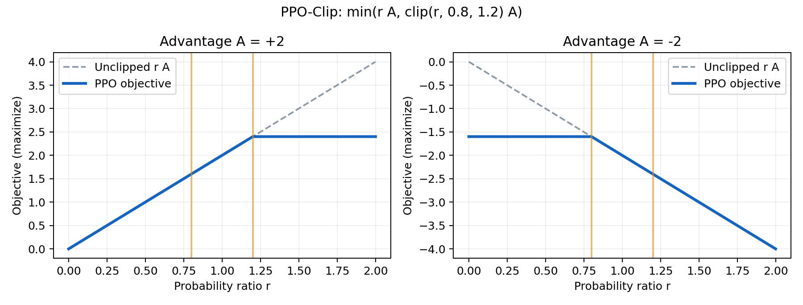

**配对代码（按顺序阅读）：** 教学实验（本课程编写）[ppo_numbers.py](../examples/lesson10/ppo_numbers.py) → 原研究团队rsl_rl源码 [ppo.py](../references/rsl_rl_v1.0.2/rsl_rl/algorithms/ppo.py) → [rollout_storage.py](../references/rsl_rl_v1.0.2/rsl_rl/storage/rollout_storage.py)。

**完整训练代码：** [train_ppo.py](../examples/lesson10/train_ppo.py) → [ppo_trainer.py](../examples/lesson10/ppo_trainer.py) → [speed_env.py](../examples/lesson10/speed_env.py)。运行方法见第 9 节。

# 第 10 课：从奖励到策略更新——手算 PPO 的关键步骤

[上一课：强化学习与 Q-learning](lesson_09_zh.md) · [学习路线](learning_path_zh.md) · [下一课：四足训练任务](lesson_11_zh.md)

第9课只需查84个数；四足机器人有连续观测和多个连续动作，无法为每种组合建一格。本课学习用参数化策略选动作、用价值函数帮助评价动作，再理解 PPO 怎样限制一次更新的诱因。完成后，应能沿“采样 → 算优势 → 更新策略与价值 → 再采样”的流程阅读训练代码。预计 90 分钟，可分两次完成。

先修是第9课的奖励/回报、折扣、bootstrap、终止/截断，以及第3课的 PD。只需能读 Python 函数和列表；知道神经网络是“输入数字、输出数字、由参数决定映射的函数”即可，不要求先会推导反向传播。

本课提供两种实验：`ppo_numbers.py` 只用标准库核对预先给定的数值；新增的 `train_ppo.py` 是使用 PyTorch 的完整 PPO-Clip 训练器，包含真实采样、策略/价值网络、自动微分、优化器、独立评估、权重保存和断点续训。训练任务是连续速度跟踪，用小型环境把下面的公式连成可运行流程。AlienGo 物理训练另见 [MuJoCo 实验](../training/aliengo_mujoco/README.md) 和第 11 课。

## 1. Actor 与 critic 各负责什么

策略 `π_θ(a|o)` 用观测o给动作a一个概率，参数θ决定这个分布。对于连续动作，这里说的是概率密度；常见做法是网络输出高斯分布的均值与标准差，再从中采样。高斯不是 PPO 的强制要求，PPO也能用于离散动作。

| 部分 | 中文意思 | 输入与输出 | 如何学习 |
|---|---|---|---|
| actor，策略 | 决定采取什么动作 | 观测 → 动作分布 | 让估计更好的动作更可能被选中 |
| critic，价值函数 `V_φ(o)` | 估计从这里继续能得多少回报 | 观测 → 一个标量价值 | 让预测靠近采样得到的价值目标 |
| advantage，优势 `A` | 这次动作比当前策略的通常表现好多少 | 由奖励、价值和后续采样估计 | 作为策略更新的方向与权重 |

价值不是位置误差，也不是即时奖励。理论上 `A^π(s,a)=Q^π(s,a)−V^π(s)`；critic也会估错，所以实际使用的是估计 `Â`。正优势鼓励提高这个动作的概率，负优势鼓励降低。actor与critic可以共用部分网络，也可以分开；本课程符号用θ、φ便于区分职责。

“训练策略”也没有取消底层控制：策略可能输出12个关节目标偏移，再由 PD 计算力矩；这取决于环境和部署契约，不能光看 PPO 名字猜动作单位。第12课会单独核查这层接口。

## 2. PPO 一轮训练的资料从哪里来

本课讨论常见的 **PPO-Clip**；PPO还有采用 KL 惩罚的版本。下表按普通训练循环解释，具体框架的变量名可能不同。

| 顺序 | 操作 | 为什么需要 |
|---|---|---|
| 1 | 固定当前策略 `π_old`，与环境交互一段 rollout | 得到当前策略亲自做出的动作及后果 |
| 2 | 保存观测、动作、奖励、旧 `log_prob`、价值、结束标志、最终下一观测价值 | 后面评价的是同一批动作，不能丢掉它们当时的概率 |
| 3 | 计算 GAE 优势与 critic 的目标 | 将即时奖励与未来估值结合 |
| 4 | 打乱 rollout 数据，分成 minibatch，小批量计算梯度并更新参数 | 一次只处理一部分样本 |
| 5 | 对同一批数据重复若干个优化 epoch | 多利用已采集的数据，同时限制策略走得太远 |
| 6 | 用更新后的策略重新采样 | PPO属于 on-policy 方法，不能无限复用陈旧经验 |

例如16个环境各采32步，共512条转移；minibatch=128，则一遍优化epoch有4个小批次；重复4遍是16次小批次更新，采样量仍是512，而不是又获得2048条新经验。这里的“epoch”指重读同一批数据的一遍；某些框架也用同名词指一整轮采样，读代码时看循环含义。

rollout长度与回合长度也不同。采32步时某个机器人可能还没倒；也可能采到中途就倒下、reset后接着采。下一节需要同时处理这些边界。多轮小批次更新的流程与裁剪目标来自 [PPO 论文，2017，式7与算法1](https://arxiv.org/abs/1707.06347)。

## 3. 先算一步“比预期好多少”，再连成 GAE

先用一步 TD 残差估计惊喜程度：

```text
δ_t = r_t + γ × bootstrap_mask_t × V(next_observation_t) − V(observation_t)
bootstrap_mask = 0 if terminated else 1
```

如果现在价值预测为.5，奖励1，下一价值预测为.6，γ=.9，则 `δ=1+.9×.6−.5=1.04`。意思是“奖励加下一步估值，比现在预期高1.04”，不是单凭奖励1就断言动作优越。

GAE（广义优势估计）把一串 TD 残差按 `γλ` 加权。本脚本从后往前计算：

```text
Â_t = δ_t + γ × λ × continuation_mask_t × Â_(t+1)
continuation_mask = 0 if terminated or truncated else 1
最后一条采样之后没有已知优势，递推 carry 从0开始
critic_target_t = Â_t + V(observation_t)
```

λ（lambda）在0到1之间。λ=0只用一步残差；λ接近1时纳入更多后续残差，通常减少对局部价值误差的依赖，但采样波动会增大。它与γ不同：γ决定未来奖励的折扣，λ决定怎样混合多步优势估计。两者变化并不自动带来更好的策略。[GAE 原论文，2015年首次发布、v6式16](https://arxiv.org/abs/1506.02438)

用下面3步、γ=.9、λ=.8，先自己从最后一行往前算：

| t | r | V当前 | V下一 | terminated | δ |
|---:|---:|---:|---:|---|---:|
| 0 | 1 | .5 | .6 | False | 1.04 |
| 1 | 1 | .6 | .7 | False | 1.03 |
| 2 | 1 | .7 | .8 | True | .30 |

最后一行虽然提供了下一价值.8，但真正终止会将它屏蔽。递推得到：

```text
Â_2 = .30
Â_1 = 1.03 + .9×.8×.30    = 1.246
Â_0 = 1.04 + .9×.8×1.246  = 1.93712
critic_target = [2.43712, 1.846, 1.0]
```

这里目标是 GAE 加旧价值得到的 λ-return 估计，不应称作每条轨迹都精确已知的真实价值。训练critic时，可最小化 `mean((V_φ(o)−target)²)`；计算actor目标时把采样算出的优势当固定数字，不能让actor通过改写优势绕过动作评价。实际实现常对优势标准化，本脚本为方便手算保留原数值。

## 4. 两个 mask 不能合并

假设只有一步，`r=1`、当前V=.5、最终下一V=2、γ=.9：

| 边界 | bootstrap | 将后一个采样的优势接过来吗？ | 本步优势 |
|---|---|---|---:|
| 任务真正终止 | 不用下一V | 不接 | `1−.5=.5` |
| 外部时间截断后 reset | 用最终下一V | 不接新回合 | `1+.9×2−.5=2.3` |
| rollout采满，但任务仍继续 | 用下一V | 本段末尾没有更多已采样残差 | `2.3` |

超时仍有未来价值，但reset之后属于另一个回合；可以 bootstrap，却不能把新回合的奖励/优势接到旧回合里。代码显式接收每条转移的 `next_values`，确保它来自**reset前最终观测**。自动reset的向量环境常另外保存最终观测，必须按所用框架接口核对。[Gymnasium 时间边界说明](https://gymnasium.farama.org/tutorials/gymnasium_basics/handling_time_limits/)

## 5. PPO 的“裁剪”究竟裁了什么

对rollout中已经采过的同一个动作，定义新旧策略的概率比：

```text
ρ_t = π_new(a_t | o_t) / π_old(a_t | o_t)
    = exp(log_prob_new − log_prob_old)
```

两次都评价旧动作，不能重新采一个新动作来做分子。分母使用采样时固定的旧策略；每个小批次更新后分子会变，分母不变。ρ=1.4表示同一动作在新策略下的概率/密度是旧策略的1.4倍，不表示动作幅度放大1.4倍。

PPO-Clip给每条样本的目标是：

```text
L_t = min(ρ_t × Â_t, clip(ρ_t, 1−ε, 1+ε) × Â_t)
actor最大化 mean(L_t)；若优化器只会最小化，就使用 loss_actor = −mean(L_t)
```

这里用ρ表示比值，避免与奖励r混淆。ε（epsilon）是更新裁剪宽度；它和第9课 ε-greedy 的探索率是两个不同参数，只是常用同一个希腊字母。

取ε=.2、Â=+2：ρ=1.4时，原项2.8、裁剪项2.4，取小的2.4；继续提高这个好动作的概率不再给这条样本更多收益。ρ=.6时原项1.2、裁剪项1.6，仍取1.2，因为朝不利方向的变化不能被裁剪“遮住”。

再取Â=−2：ρ=.6时原项−1.2、裁剪项−1.6，**取较小的−1.6**，限制把坏动作概率降低过多的收益；ρ=1.4时得到−2.8，坏动作变得更可能，惩罚仍保留。优势为负也仍然是对两个乘积取min，不能因为看到负数就擅自改成max。



图中横轴的r就是本课ρ，蓝线是要最大化的目标，灰虚线是未裁剪的 `ρ×Â`；橙线标出.8与1.2。左图只有超过1.2后变平，右图只有低于.8时变平。两边都保留朝不利方向变化的斜线部分，所以并不是“把所有目标数值夹在两个固定上下限之间”。

这裁的是代理目标里的概率比，不是电机动作、关节角限幅或物理安全边界。共享网络参数仍可能让其他动作概率大变；裁剪也不保证每轮回报一定提高，完整训练器通常还监控 KL、熵、价值误差和真实评估回报。[OpenAI Spinning Up：PPO-Clip 目标与局限](https://spinningup.openai.com/en/latest/algorithms/ppo.html)

## 6. 把手算结果交给程序核对

```bash
cd /home/jack/aliengo_learning
./scripts/ros1_course.sh offline lesson10/ppo_numbers.py --help
./scripts/ros1_course.sh offline lesson10/ppo_numbers.py
```

默认命令在已有无网络容器中的实跑输出：

```text
gamma=0.9 lambda=0.8 clip=0.2 (numerical lab, no training)
terminal rollout: rewards=[1,1,1] V=[0.5,0.6,0.7] V_next=[0.6,0.7,0.8]
 t       delta    advantage     V_target
 0    1.040000     1.937120     2.437120
 1    1.030000     1.246000     1.846000
 2    0.300000     0.300000     1.000000
single step: reward=1 V=0.5 V_next=2
terminal advantage=0.500000 timeout advantage=2.300000
 ratio   advantage      raw    PPO_objective(maximize)
  0.60        2.00     1.20                        1.20
  0.90        2.00     1.80                        1.80
  1.10        2.00     2.20                        2.20
  1.40        2.00     2.80                        2.40
  0.60       -2.00    -1.20                       -1.60
  0.90       -2.00    -1.80                       -1.80
  1.10       -2.00    -2.20                       -2.20
  1.40       -2.00    -2.80                       -2.80
```

这些ratio与优势是为了分离概念刻意给定的案例；表中每一行独立检查公式，并不是同一个完整动作分布，也不是一次真实策略更新。可以用 [数值测试](../tests/test_lesson09_10.py) 查看跨reset和rollout边界的更多反例，原始执行记录见 [验证报告](reports/rl-foundations.md)。

## 7. 一次只改一个变量

**练习 A：** 只设λ=0，先预测三条优势；PPO裁剪表会改变吗？

```bash
./scripts/ros1_course.sh offline lesson10/ppo_numbers.py --lam 0
```

实测优势为 `[1.04,1.03,.30]`，critic目标变成 `[1.54,1.63,1]`。一步TD残差不变，优势不再叠加后续残差。裁剪表使用独立给定的±2，因而不变。这是教学脚本的隔离安排，完整训练里优势改变通常会影响actor梯度。

**练习 B：** 回到默认λ，只把ε从.2改成.1。正优势ρ=1.4、负优势ρ=.6分别会变成多少？

```bash
./scripts/ros1_course.sh offline lesson10/ppo_numbers.py --clip 0.1
```

实测两项从 `2.4→2.2`、`−1.6→−1.8`，GAE表不变。缩窄窗口限制了沿有利方向走远的目标收益；它并不能代替选择合理学习率、优化步数和观测动作定义。

## 8. 接着读代码与训练日志

打开 [ppo_numbers.py](../examples/lesson10/ppo_numbers.py)，按以下顺序看：

1. `gae()` 中 `bootstrap` 与 `continuation` 两行：说明各自在哪些边界为0。
2. `reversed(range(size))` 与 `carry`：为什么本课从后往前算优势？
3. `clipped_surrogate()` 的 `return min(raw, clipped)`：代入负优势再检查一次符号。
4. `experiment()`：找出哪些数是给定的、哪些是计算出来的。这里没有 `optimizer.step()`。

以后读完整PPO时，可以将常见日志对应到本课概念：`episode_return` 是环境交互结果，`value_loss` 是critic拟合误差，`entropy`描述策略随机性，`approx_kl`描述新旧分布的变化，`clip_fraction`统计ratio超出窗口的比例（定义依框架核查）。actor loss的正负不能单独说明机器人表现；先看独立评估的跟踪误差、倒地率和回报。

训练时通常从分布采样以探索并更新参数；评估时关闭学习，常使用高斯均值或其他规定的确定性动作，也可以额外评估随机采样策略的稳健性。必须记录选择方式，不能拿两种不同协议的分数直接比较。确定性推理不是“把关节输出固定不变”，它仍随每帧观测变化。

下面的完整训练器会产生连续速度任务的策略权重。下一课继续设计四足训练任务，并分清作者参考实现、当前模型以及本机实际验证过的范围。

## 9. 运行完整 PPO 训练器

### 9.1 任务、网络与代码流程

这里将第 9 课的离散速度跟踪扩展为连续任务。环境每步为 0.2 秒，观测是 `[当前速度 / 0.8, 目标速度 / 0.4]`；目标速度从 `[-0.4, -0.2, 0.2, 0.4] m/s` 中选择，一回合内保持不变。初始速度在 `[-0.4, 0.4) m/s` 内均匀采样。

actor 和 critic 分别使用 `2 → 64 → 64 → 1` 的网络。actor 输出高斯均值，同时学习标准差；采样原始动作 `u` 后，环境执行 `a=tanh(u)`。速度按 `v_next=v+0.1×a+wind` 更新，`wind` 为标准差 `0.01 m/s` 的零均值高斯扰动。奖励为 `1−(速度误差/0.2)²−0.01×a²`；速度绝对值超过 `0.8 m/s` 时真正终止并额外扣 5，运行满 `horizon` 步则截断。

训练器没有依赖 SB3 的 PPO 实现，主要步骤都能在源码中找到：

| 代码 | 对应的学习步骤 |
|---|---|
| `ActorCritic.distribution()` / `sample()` | 从高斯策略采样动作并保存旧 log 概率与旧价值 |
| `ActorCritic.log_prob()` | 计算经过 tanh 的动作密度，包含变量变换修正，避免将限幅前后动作混淆 |
| `PPOTrainer.collect_rollout()` | 采样一段数据，先用最终观测算下一价值，再 reset 已结束的环境 |
| `compute_gae()` | 分别处理 bootstrap 与 continuation mask，算出优势和价值目标 |
| `PPOTrainer.update()` | 全批优势标准化，打乱数据，多 epoch、小批量更新 actor 和 critic |
| `clipped_policy_loss()` | 对新旧概率比裁剪，并对正负优势都取两个乘积的 min |
| `loss.backward()` / `optimizer.step()` | 自动微分和 Adam 参数更新，同时限制梯度总范数 |
| `evaluate()` | 固定独立评估随机流，执行 `tanh(均值)`，关闭梯度和学习 |
| `save_checkpoint()` / `load_checkpoint()` | 保存与恢复网络、优化器、环境、随机状态和计数器 |

近似 KL 超过 `1.5 × target_kl` 时，提前停止当前 rollout 的剩余优化，再采集新数据。日志中的 `base_entropy` 是 **tanh 前高斯分布的熵**，并非变换后动作分布的熵。训练环境批量运行在单个进程中，网络与环境张量均使用所选 CPU 或 CUDA 设备。

### 9.2 环境与 GPU

使用项目独立的 `.venv-ppo`，与 ROS 1 容器中的 Python/PyTorch 分开。本次实现使用 Python 3.12 和 PyTorch 2.7.1 CUDA 12.8；显卡检查识别到 RTX 5060 Laptop（约 8 GB 显存）。安装版本参考 [PyTorch 官方安装命令](https://pytorch.org/get-started/previous-versions/)；[PyTorch 2.7 说明](https://pytorch.org/blog/pytorch-2-7/)介绍了 Blackwell 支持。

首次重建环境时执行；如果当前 `.venv-ppo` 已准备好，可直接跳到训练命令：

```bash
cd /home/jack/aliengo_learning
python3 -m venv .venv-ppo
.venv-ppo/bin/python -E -m pip install -r examples/lesson10/requirements-cuda.txt
```

若 Ubuntu 提示缺少 `ensurepip`，需先准备与系统 Python 匹配的 `python3-venv` 包。`--help` 可查看训练器的中文参数说明：

```bash
./scripts/lesson10_ppo.sh --help
```

### 9.3 开始一次新的 GPU 训练

```bash
cd /home/jack/aliengo_learning
./scripts/lesson10_ppo.sh \
  --device cuda \
  --output results/lesson10_ppo \
  --updates 80
```

默认每轮 8 个环境各采 64 步，所以总采样量为 `80×8×64=40960` 条转移。每轮对同一批数据优化 4 遍，minibatch 为 128；每回合上限 80 步。PPO 的 `updates` 是“采样一批并优化”的轮数，与第 9 课的回合数 `episodes` 不同。

启动行会打印实际 `device`、GPU 名称与 PyTorch 版本。`--device cuda` 无法使用时会报错；`--device cpu` 明确选择 CPU；默认 `auto` 在 CUDA 可用时选择 GPU。这个小任务网络很小，GPU 未必比 CPU 更快，使用 GPU 的目的之一是验证计算环境。

下面这些参数可用于**新训练**，先保持默认跑通，再一次只改一个：

| 参数 | 默认值 | 含义 |
|---|---:|---|
| `--num-envs` | 8 | 同时采样的环境数 |
| `--rollout-steps` | 64 | 一轮中每个环境采样多少步 |
| `--horizon` | 80 | 一个回合最多多少步 |
| `--epochs` | 4 | 同一批数据重复优化多少遍 |
| `--minibatch-size` | 128 | 一次梯度更新读取多少条样本 |
| `--learning-rate` | 0.0003 | Adam 学习率 |
| `--gamma` / `--lam` | 0.95 / 0.95 | 奖励折扣与 GAE 混合系数 |
| `--clip` | 0.2 | PPO 概率比裁剪宽度 |
| `--seed` | 7 | 训练随机种子 |
| `--eval-episodes` | 32 | 每次评估的回合数 |
| `--eval-every` / `--save-every` | 20 / 20 | 评估与保存的间隔轮数 |

输出目录必须是新目录；再次从零训练时更换 `--output` 名称。启动脚本与现有训练/仿真入口使用同一互斥锁，运行前会检查仿真状态。

### 9.4 日志与保存内容

终端先显示 `before`，再输出优化指标与周期评估，结束时显示 `after`。`mean_return` 是每回合奖励直接求和；`mean_discounted_return` 才是本课前面讨论的折扣回报。`MAE` 单位为 m/s，`terminal` 表示速度越界失败比例；运行到步数上限属于截断，不计入失败。

日志中的 `policy_loss`、`value_loss`、`approx_kl` 和 `clip_fraction` 用来检查优化过程。训练效果主要看独立评估的回报、速度误差和失败率。评估使用种子 10000 创建独立批量随机流，固定确定性动作，不修改训练参数或采样 RNG；周期评估用于观察进展，没有自动从中挑选“最好”权重。

训练目录包含：

| 文件 | 内容 |
|---|---|
| `metrics.jsonl` | 每轮损失、KL、裁剪比例、交互计数和周期评估；每行一个 JSON |
| `checkpoint_00020.pt` 等 | 指定轮次的完整训练状态 |
| `last.pt` | 最近完成保存的训练状态，可用于评估和续训 |
| `report.json` | 最终生效配置、实际设备与版本、训练前后指标、耗时和计数 |

checkpoint 在一轮更新结束后保存；若中途退出，可从最近一次已保存的轮次继续。权重是这个两维观测、一维动作的速度任务策略，AlienGo 的关节策略需要使用对应的物理环境重新训练。

### 9.5 加载评估与断点续训

只加载并评估，不更新参数：

```bash
./scripts/lesson10_ppo.sh \
  --device cuda \
  --evaluate results/lesson10_ppo/last.pt
```

从已有权重**额外训练 40 轮**，将结果保存到新目录：

```bash
./scripts/lesson10_ppo.sh \
  --device cuda \
  --resume results/lesson10_ppo/last.pt \
  --output results/lesson10_ppo_more \
  --updates 40
```

续训自动沿用 checkpoint 中的全部训练配置，并恢复优化器、未完成回合和随机状态。此时不再额外指定 `--seed`、`--gamma`、`--num-envs` 等训练参数，避免误以为已经更改了旧实验。续训要求 CPU/CUDA 设备类型与保存时相同；单独评估可以跨设备加载。

### 9.6 验证方法

原有手算测试继续使用标准库运行；新增训练器测试需使用有 PyTorch 的独立环境：

```bash
python3 -m unittest discover -s tests -p test_lesson09_10.py
.venv-ppo/bin/python -E -m unittest discover -s tests -p test_lesson10_trainer.py
```

测试核对终止/截断的 GAE、tanh 动作密度、正负优势梯度、采样数据冻结、网络实际更新、评估无副作用、checkpoint 往返与同设备续训。完整实跑的设备和指标见 [训练器验证报告](reports/lesson10-ppo-trainer.md)。

## 10. 排错与验收

| 现象 | 如何定位 |
|---|---|
| 算得终止行δ=1.02 | 忘了终止时屏蔽 `.8` 的下一价值；正确是 `.30` |
| 超时优势只有.5 | 把 `terminated or truncated` 当成bootstrap屏蔽条件了 |
| reset后上一回合优势突然很大 | 检查GAE是否跨回合递推，或误用新回合初始观测价值 |
| 负优势ρ=.6算成−1.2 | 应对两个乘积取min，正确−1.6 |
| 运行 `ppo_numbers.py` 没有进步曲线 | 该入口用于手算核对；真实训练使用第 9 节的 `train_ppo.py` |
| 请求 CUDA 时报错 | 使用 `.venv-ppo` 中的 CUDA 版 PyTorch，并检查 `nvidia-smi`；终端启动行会显示实际设备 |
| 输出目录已存在 | 新训练或续训改用新目录；原报告和权重保留 |
| 续训提示额外训练参数 | 参数从 checkpoint 恢复，只需指定设备、输入权重、新输出目录和额外轮数 |
| 参数报错 | γ与λ须在 `[0,1]`、clip在 `[0,1)`，NaN/Inf及溢出会被拒绝 |

1. rollout里保存旧log概率有什么用？一轮中的多个minibatch更新能否每次把分母改成当前策略？
2. γ=.9、λ=.8、δ序列 `[1.04,1.03,.30]`，真正终止在最后一条，第一条优势是多少？若λ=0呢？
3. Â=−2、ρ=.6、ε=.2时目标是多少？裁剪是否保证动作不超过关节限位？

<details>
<summary>参考答案：核对数值，也解释原因</summary>

1. 它记录动作被采样时的概率，用于计算新旧策略比值。分母固定为采样策略；不断换分母会改变这一批数据的参照，失去本课PPO代理目标的含义。分子始终重新评价同一旧动作。
2. `Â_1=1.03+.72×.30=1.246`，`Â_0=1.04+.72×1.246=1.93712`。λ=0时第一条仅为1.04。
3. 原项−1.2，裁剪项 `.8×(−2)=−1.6`，取min得到−1.6。这里只裁概率比对代理目标的贡献，关节位置、速度、力矩约束需要在动作与控制接口中另行处理。

</details>

一手资料（核查于2026-11-11）：[PPO论文v2：式7、9与算法1](https://arxiv.org/abs/1707.06347v2)、[GAE论文v6：优势估计](https://arxiv.org/abs/1506.02438v6)、[OpenAI Spinning Up PPO讲解](https://spinningup.openai.com/en/latest/algorithms/ppo.html)、[Gymnasium终止与截断](https://gymnasium.farama.org/tutorials/gymnasium_basics/handling_time_limits/)。这些资料用于阅读与核查，运行本课无需安装其实现。

[上一课](lesson_09_zh.md) · [下一课：四足训练任务](lesson_11_zh.md)
