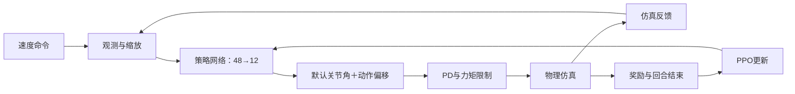

**配对代码（按顺序阅读）：** 本课直接阅读训练源码（社区AlienGo分支）：[aliengo_flat_config.py](../references/legubiao_legged_gym/legged_gym/envs/unitree/aliengo/flat/aliengo_flat_config.py) → [aliengo_config.py](../references/legubiao_legged_gym/legged_gym/envs/unitree/aliengo/aliengo_config.py) → [legged_robot.py](../references/legubiao_legged_gym/legged_gym/envs/base/legged_robot.py) → [train.py](../references/legubiao_legged_gym/legged_gym/scripts/train.py)。

# 第11课：设计AlienGo强化学习任务，读懂可复现的训练路线

[上一课：PPO与训练诊断](lesson_10_zh.md) · [课程目录](course_index_zh.md) · [下一课：策略推理与部署契约](lesson_12_zh.md)

建议分两次学习，每次60分钟。前置是第3课的PD、第6课的IMU与坐标系，以及第9～10课的回报、PPO和训练/评估区别。本课目标是写清一个四足任务的输入、输出、时间和验收标准，并沿固定源码找到真正的AlienGo训练入口。

**本次实际完成的是小型参考源码下载、版本锁定和CPU源码检查。完整四足训练、策略评估与导出尚未实跑。** 主机PCI可见Intel与NVIDIA设备，NVIDIA设备经型号核查为RTX 5060 Laptop；缺少可用的 `nvidia-smi` 与PyTorch训练环境不等于没有GPU硬件。下面的旧Isaac Gym路线用于阅读和在相容旧环境中复现，不能视为这台Blackwell笔记本的已验证安装方案。验证范围见[训练核查报告](reports/rl-training.md)。

## 1. 先把“学会走路”改成可检查的任务

先做平地速度跟踪：给出机身坐标系中的前向速度、横向速度与偏航角速度，策略连续产生12个关节的位置偏移；PD依据这些目标生成仿真力矩。第一轮先检查站立、零速度、低速直行和转弯，再扩展速度与地形范围。



任务说明至少包含：命令范围、地面、初始姿态、传感来源、观测/动作顺序、控制周期、终止条件和评估指标。改变其中任何一项都可能改变策略所面对的问题；“同为12关节四足”不足以复用模型。

本课选作者仓库中的 `aliengo_flat`：平地、48维观测、12维动作，实验目录名为 `flat_aliengo`。另一个 `aliengo` 是粗糙地形任务，继承187个高度采样，观测为235维；两者不能共用同一输入形状。依据是[固定AlienGo平地配置](https://github.com/legubiao/legged_gym/blob/e91e7b346cfcf6b3da12b02a58c0bdf0e6f482c5/legged_gym/envs/unitree/aliengo/flat/aliengo_flat_config.py)与[本地基础配置](../references/legubiao_legged_gym/legged_gym/envs/base/legged_robot_config.py)。

## 2. 先确认“哪个仓库真的有AlienGo”

这些参考放在 `references/`；当前 ROS 1 仿真使用 Guide，尚未加载强化学习策略。训练环境与 ROS 1 仿真环境是两套独立系统。

| 本地参考 | 固定版本 | 本课用途 |
|---|---|---|
| [legged_gym原始仓库](../references/legged_gym/README.md) | master，`8fa29acc6fd1910c3d9659eef6310bdd301cde0a` | 阅读任务结构；该提交未注册AlienGo |
| [控制器作者的legged_gym分支](../references/legubiao_legged_gym/README.md) | master，`e91e7b346cfcf6b3da12b02a58c0bdf0e6f482c5` | 实际注册 `aliengo`、`aliengo_flat`，含小型AlienGo模型资源 |
| [rsl_rl](../references/rsl_rl_v1.0.2/README.md) | **v1.0.2**，`2ad79cf0caa85b91721abfe358105f869a784121` | 与这条旧训练路线相配的PPO实现 |

原始仓库的[固定任务注册表](https://github.com/leggedrobotics/legged_gym/blob/8fa29acc6fd1910c3d9659eef6310bdd301cde0a/legged_gym/envs/__init__.py)列出ANYmal、A1和Cassie。直接在原始仓库运行 `--task=aliengo_flat` 会找不到任务，需要增加模型、配置和注册。作者分支的[注册表](../references/legubiao_legged_gym/legged_gym/envs/__init__.py)才提供本课的入口。

固定 `rsl_rl` 不是形式要求。v1.0.2的[runner](../references/rsl_rl_v1.0.2/rsl_rl/runners/on_policy_runner.py)读取 `train_cfg["runner"]`，建立 `ActorCritic`，环境的 `step()` 返回五项；2026-11-11核查的[当前runner，commit 8945bdc](https://github.com/leggedrobotics/rsl_rl/blob/8945bdcbc364f388e14caebf547dbf302d89e491/rsl_rl/runners/on_policy_runner.py)使用另一套算法构建与四项 `step()` 契约。不能把当前 `pip install rsl-rl-lib` 与这份旧环境直接组合。

三个下载仓库的源码许可证均为BSD-3-Clause，保留了原始声明。作者分支的根LICENSE要求另查资产许可证；该提交没有单独的AlienGo资产许可证文件，本课记录这一来源缺口，没有把所有模型资产都推定为BSD。URL、ref、SHA、稀疏下载范围及许可证文件见[下载记录](reports/rl-training-repositories.json)；更多一手资料见[RL资料索引](rl_sources_zh.md)。

## 3. 现在就能运行：不用安装训练框架的源码检查

在项目根目录运行。Python只解析文本与XML，不导入torch或Isaac Gym，不连接机器人。

```bash
cd /home/jack/aliengo_learning
python3 - <<'PY'
import ast
from pathlib import Path
import xml.etree.ElementTree as ET

root = Path("references/legubiao_legged_gym")
base = root / "legged_gym/envs/base/legged_robot_config.py"
robot = root / "legged_gym/envs/unitree/aliengo/aliengo_config.py"
flat = root / "legged_gym/envs/unitree/aliengo/flat/aliengo_flat_config.py"

def value(path, *names):
    node = ast.parse(path.read_text())
    for name in names[:-1]:
        node = next(n for n in node.body if isinstance(n, ast.ClassDef) and n.name == name)
    assignment = next(n for n in node.body if isinstance(n, ast.Assign)
                      and any(isinstance(t, ast.Name) and t.id == names[-1] for t in n.targets))
    return ast.literal_eval(assignment.value)

dt = value(base, "LeggedRobotCfg", "sim", "dt")
decimation = value(robot, "AliengoRoughCfg", "control", "decimation")
n = value(base, "LeggedRobotCfg", "env", "num_envs")
steps = value(base, "LeggedRobotCfgPPO", "runner", "num_steps_per_env")
obs = value(flat, "AliengoFlatCfg", "env", "num_observations")
actions = value(base, "LeggedRobotCfg", "env", "num_actions")
urdf = root / "resources/unitree/aliengo/urdf/robot.urdf"
tree = ET.parse(urdf)
joints = [j.attrib["name"] for j in tree.findall("joint") if j.attrib["type"] != "fixed"]
assert obs == 48 and actions == len(joints) == 12
for mesh in tree.findall(".//mesh"):
    assert (urdf.parent / mesh.attrib["filename"]).is_file()
assert 'register("aliengo_flat"' in (root / "legged_gym/envs/__init__.py").read_text()
print(f"obs={obs} actions={actions} movable_joints={len(joints)}")
print(f"physics_hz={1/dt:.1f} policy_hz={1/(dt*decimation):.1f}")
print(f"rollout_s={steps*dt*decimation:.2f} batch={n*steps}")
print("urdf_xml_order=" + ",".join(joints[::3]))
PY
```

应看到：

```text
obs=48 actions=12 movable_joints=12
physics_hz=200.0 policy_hz=50.0
rollout_s=0.48 batch=98304
urdf_xml_order=FR_hip_joint,FL_hip_joint,RR_hip_joint,RL_hip_joint
```

这里最后一行只是URDF中的XML排列。实际训练顺序来自仿真导入后的 `gym.get_asset_dof_names()`，完整环境首次创建时必须记录它，并按关节名构建部署映射。不能把XML排列、Python默认角字典的插入顺序或ROS YAML排列直接等同于运行时顺序。

**先预测：** 把decimation从4改成2，而物理步长不变，策略频率和每轮rollout时长如何变化？只在纸上计算：100 Hz、0.24 s。本次无需修改已锁定参考源码。

## 4. 把48维观测写成明确契约

以下顺序来自[compute_observations()](../references/legubiao_legged_gym/legged_gym/envs/base/legged_robot.py)，索引采用Python左闭右开区间。噪声添加后，整条观测再裁剪到[-100,100]。

| 索引 | 内容 | 原始单位/含义 | 乘数 |
|---|---|---|---|
| `[0:3]` | 机身线速度x,y,z | m/s，机身坐标系 | 2.0 |
| `[3:6]` | 机身角速度x,y,z | rad/s，机身坐标系 | 0.25 |
| `[6:9]` | 重力方向在机身系的投影 | 单位方向向量，无量纲 | 1 |
| `[9:12]` | 目标vx、vy、yaw rate | m/s、m/s、rad/s | 2.0、2.0、0.25 |
| `[12:24]` | `q - q_default` | rad，按训练DOF顺序 | 1.0 |
| `[24:36]` | 关节速度 | rad/s，同一DOF顺序 | 0.05 |
| `[36:48]` | 上一策略步实际使用的动作 | 无量纲，经过动作裁剪 | 1 |

姿态处理使用Isaac Gym的 **x,y,z,w** 四元数，世界重力方向为[0,0,-1]；投影重力不是IMU加速度的直接复制。平地配置没有观测history堆叠；基础配置也没有另给critic的特权观测。

尤其注意第一组线速度：训练源码由仿真root state计算得到，真机IMU不能直接给出同等质量的线速度。部署需要明确机身系速度估计及其误差，或重新训练不依赖该输入的策略。换成全零、世界系速度或未标定估计器，输入维数虽然没变，语义已经变了。

基础命令每10秒重采样，vx、vy范围均为[-1,1] m/s。默认开启heading命令模式，内部第四个命令是目标航向，偏航角速度由航向误差计算；网络仍只接收前三项。若实验要求直接指定yaw rate，应在独立实验配置里关闭heading模式，并把这一变动记录下来。

## 5. 动作经过PD才成为力矩

[AlienGo配置](../references/legubiao_legged_gym/legged_gym/envs/unitree/aliengo/aliengo_config.py)选择位置控制，参考目标为：

```text
a_used = clip(a_network, -100, 100)
q_target = q_default + 0.25 × a_used
tau = clip(60 × (q_target - q) - 3 × dq, -tau_URDF, tau_URDF)
```

动作无量纲，0.25的单位可理解为rad/动作单位；q与dq分别用rad和rad/s。参考默认角每条腿为hip=0、thigh=0.8、calf=-1.5 rad。Kp=60 N·m/rad、Kd=3 N·m·s/rad是这份训练配置的参数，不是本课程推荐的真机参数。URDF中的仿真力矩上限由模型属性读取，不能当成实际电机持续工作上限。

**小算例：** 某thigh输出0.4，目标为0.8+0.25×0.4=0.9 rad。若当前q=0.85 rad、dq=0.2 rad/s，未限幅PD力矩为60×0.05-3×0.2=2.4 N·m。动作裁剪到100不代表允许100 rad的关节角；动作、位置与力矩约束必须分别核查。

物理步长0.005秒，策略每4个物理步更新一次，因此策略周期0.02秒。持有同一动作的4步中，每个物理步都重新读取关节状态并计算PD力矩。这与“只算一次力矩然后保持4步”不同。

并行4096个环境、每轮24个策略步，得到98,304条transition，每个环境覆盖0.48秒。把环境数降到4便于调试，但每轮只剩96条样本；默认4个mini-batch各24条，优化条件与完整训练差别很大。比较配置时应同时记录总transition数、策略更新时间、仿真吞吐量和墙钟时间。

## 6. 奖励、结束与随机化分别承担什么

先按物理量解释奖励，再调权重。下表是AlienGo覆盖项与继承项的示例；完整集合以[基础奖励配置](../references/legubiao_legged_gym/legged_gym/envs/base/legged_robot_config.py)和[奖励函数](../references/legubiao_legged_gym/legged_gym/envs/base/legged_robot.py)为准。

| 项目 | 该提交的权重 | 希望的行为与观察点 |
|---|---:|---|
| 平面速度跟踪 | 2.0 | `exp(-平方误差/0.25)`；同时看m/s误差，避免只看奖励 |
| 偏航角速度跟踪 | 0.5 | 转弯跟随命令，同时看rad/s误差 |
| 力矩平方 | -0.000007 | 减少用力；过大可能学成少动 |
| 关节软位置限位 | -15 | 接近模型软限位时惩罚，比例0.9 |
| 机身高度误差 | -1 | 目标0.45 m；需结合倾倒率解释 |
| 动作相邻步差平方 | -0.01 | 减少动作抖动；同时看实际关节速度 |

源码把非零奖励权重乘以策略周期dt，再累加；还开启 `only_positive_rewards`，会把普通奖励总和的负部分裁成0。因此改变dt、裁剪或奖励权重后，总reward不能直接与旧实验横比。奖励函数返回值、带权每项贡献、速度误差、终止原因应一起保存。

该任务在指定机身接触超过阈值或约20秒超时后reset，实际接触体索引要检查模型导入结果。环境通过 `time_outs` 标记超时，但这份旧代码的处理与第10课的最终状态bootstrap有差别：[rsl_rl的act()/process_env_step()](../references/rsl_rl_v1.0.2/rsl_rl/algorithms/ppo.py)先在动作前保存当前 `V(o_t)`，超时时把 `γ×V(o_t)` 加到reward；它没有在这里计算reset前最终观测的 `V(o_(t+1))`。随后storage按done截断递推，因此这个补偿使用了当前状态价值，不能将它与第10课的处理视为数值等价。

用第10课的一步例子：r=1、当前V=.5、最终下一V=2、γ=.9，旧实现补偿后的优势为 `1+.9×.5−.5=.95`；按最终状态bootstrap应为 `1+.9×2−.5=2.3`。两者差异取决于相邻状态的价值，可能引入价值目标偏差。这里保留锁定源码供复现；新环境应明确传递最终观测、区分真正终止/时间截断，并按第10课的两种mask核对，不因旧代码能运行就直接照搬。

域随机化在一组物理条件中训练：本配置继承摩擦系数[0.5,1.25]、观测噪声、每15秒一次的随机平面速度扰动（最大1 m/s）；基础质量随机化默认关闭。这里“push”是直接改机身速度来模拟冲击，并非完整的外力作用模型。电机强度、延迟、Kp/Kd变化、质量/质心偏差需要独立增加配置与实现，不能因论文写过Sim2Real就假设当前任务全部具备。

课程学习逐渐改变难度：粗糙地形可依据表现升降地形级别；平地任务运行时关闭地形课程，命令课程默认也关闭。可先收紧低速命令并验证，再逐级扩大；每次只改一个因素，保留相同评估集合。随机化描述“条件有哪些”，课程学习描述“何时让条件变难”。

## 7. 完整训练的条件步骤：先准备相容环境

**本节所有安装、仿真、训练、play与导出命令均为条件步骤，本机未执行。** CPU源码检查不需要这些依赖；CPU运行完整四足环境仍需要Isaac Gym和PyTorch。

作者分支[固定README](https://github.com/legubiao/legged_gym/blob/e91e7b346cfcf6b3da12b02a58c0bdf0e6f482c5/README.md)给出的旧组合是Python3.8、PyTorch1.13.1/CUDA11.7、Isaac Gym Preview4、rsl_rl v1.0.2；其[setup.py](../references/legubiao_legged_gym/setup.py)还固定numpy1.23.5、setuptools59.5.0。先在相容机器的独立环境中验证Isaac Gym自带例子；不要把系统Python或 ROS 1 仿真容器当成这一训练环境。

NVIDIA已把[Isaac Gym标为停止支持的旧软件](https://developer.nvidia.com/isaac-gym)。Blackwell需要匹配的新运行栈；例如[PyTorch2.7发布说明](https://pytorch.org/blog/pytorch-2-7/)记录了Blackwell与CUDA12.8支持的引入，但这不能证明旧Isaac Gym二进制也兼容。升级torch一项并不能解决整个栈的相容性。

更适合后续本机探索的路线是另建现代Isaac Lab任务。2026-11-11核查的[Isaac Lab v3.0.0安装说明](https://isaac-sim.github.io/IsaacLab/v3.0.0/source/isaaclab/installation.html)默认采用Newton，Isaac Sim可选，Python/CUDA/驱动与旧栈不同。需要重新核查所选版本及后端、显存、驱动、资产导入、动作/观测和算法API，先让对应官方小任务运行，再移植AlienGo；本课没有完成该移植，也没有提供虚构的现代AlienGo任务名。

在**已经准备好上述旧依赖**的环境中，从项目根目录安装两份锁定源码；`--no-deps`避免安装器自行选择新版本，只安装作者分支这一份 `legged_gym`：

```bash
cd /home/jack/aliengo_learning
python -m pip install --no-deps -e references/rsl_rl_v1.0.2
python -m pip install --no-deps -e references/legubiao_legged_gym
cd references/legubiao_legged_gym
```

先用零动作检查环境。上游测试会给默认角目标，并不学习：

```bash
python legged_gym/tests/test_env.py --task=aliengo_flat --num_envs=4 \
  --sim_device=cpu --rl_device=cpu --headless
```

再用极小规模检查PPO数据路径，不能据此声称策略会走路：

```bash
python legged_gym/scripts/train.py --task=aliengo_flat --num_envs=4 \
  --sim_device=cpu --rl_device=cpu --headless --max_iterations=2 \
  --seed=1 --run_name=cpu_smoke
```

在已确认支持该旧栈的GPU机器上，单个训练seed的完整参考入口为：

```bash
python legged_gym/scripts/train.py --task=aliengo_flat --num_envs=4096 \
  --sim_device=cuda:0 --rl_device=cuda:0 --headless \
  --max_iterations=1500 --seed=1 --run_name=full_s1
```

入口来自[train.py](../references/legubiao_legged_gym/legged_gym/scripts/train.py)，参数来自[helpers.py](../references/legubiao_legged_gym/legged_gym/utils/helpers.py)。预期生成 `logs/flat_aliengo/<日期时间>_full_s1/model_1500.pt`；路径构造以[task_registry.py](../references/legubiao_legged_gym/legged_gym/utils/task_registry.py)为准。模型文件出现只证明保存发生，不能证明跟踪质量达标。

## 8. 评估与导出：明确选择run和checkpoint

仍在上一节作者分支目录中，把变量改成**实际训练产生的目录名**；下面时间只是格式示例。先确认指定checkpoint存在，成功后才运行play：

```bash
RL_RUN=Nov11_20-00-00_full_s1
test -f "logs/flat_aliengo/$RL_RUN/model_1500.pt" && \
python legged_gym/scripts/play.py --task=aliengo_flat --num_envs=4 \
  --sim_device=cpu --rl_device=cpu --headless \
  --load_run="$RL_RUN" --checkpoint=1500
```

[play.py](../references/legubiao_legged_gym/legged_gym/scripts/play.py)通过 `get_inference_policy()` 使用actor均值，默认关闭观测噪声、摩擦随机化和push，适合观察干净场景。它还绘制状态图，纯无图形会话可先设置 `MPLBACKEND=Agg`。这是播放检查入口；它没有实现下一节的完整held-out评估器。

**本固定版本没有 `--export` 或 `--export_policy` 命令行开关。** `play.py` 中的 `EXPORT_POLICY=True` 默认开启导出，非循环策略会保存为：

```text
logs/flat_aliengo/exported/policies/policy_1.pt
```

这个文件是[export_policy_as_jit()](../references/legubiao_legged_gym/legged_gym/utils/helpers.py)导出的CPU TorchScript actor，供匹配的C++运行时加载；训练checkpoint则是含模型/优化器状态的字典，不能直接当作同一文件。上游导出目录不会按run隔离，后一次play可能覆盖前一次文件，实验归档时要另存带run与checkpoint标识的副本并记录SHA256。

导出物仍需要旁边的契约清单：DOF名字顺序、q_default、缩放、裁剪、坐标系、策略周期、PD参数、传感来源、模型版本和history/reset规则。导出成功后还应在同一组观测上比较原actor与JIT的输出，检查形状 `[batch,48]→[batch,12]`、有限值和误差；本机未执行这项数值比对。

## 9. 不靠一次视频判断训练成功

下面是本课程建议的实验协议，**不是已得到的结果，也不是上游play自动提供的功能**。实现评估记录器后，冻结策略、不更新梯度，使用独立的评估seed与命令序列；先固定任务，再比较权重。

| 维度 | 第一轮建议记录 |
|---|---|
| 基线 | 默认角零动作PD，与训练策略使用同一评估集合 |
| 训练重复 | 至少3个训练seed：1、2、3；相同transition预算与配置 |
| 验证集 | 用于选checkpoint/奖励权重，独立于训练随机序列 |
| held-out测试集 | 最后一次使用；如seed1001～1010、预先固定的停走/转弯序列、未参与调参的摩擦和小坡度组合 |
| 跟踪误差 | vx/vy RMSE（m/s）、yaw rate RMSE（rad/s），按命令段报告 |
| 稳定性 | 跌倒率、存活秒数、完成指定时长的回合比例；区分失败与超时 |
| 控制代价 | 力矩RMS（N·m）、限幅占比、关节越界次数、动作变化RMS |
| 性能 | steps/s、训练墙钟、峰值显存、推理延迟分位数 |
| 汇总 | 每个训练seed单独报告，再给跨seed均值与标准差；不能只挑最好seed |

固定seed仍不保证GPU物理仿真逐位一致，记录依赖版本和设备很有必要。也不要用测试集反复选权重；那会把“未见过的条件”变成调参数据。阈值应在测试前写下，例如在给定低速命令集合上要求何种RMSE和完成率，本课没有把任意教学阈值声称为真机合格标准。

**这个旧版本还有一个seed陷阱：** `--seed` 在创建runner时才覆盖train_cfg，而环境早已在 `make_env()` 里按旧 `env_cfg.seed` 调用了 `set_seed()`。仅把上面的命令改成 `--seed=2`，不能保证第二个独立随机实验。多seed训练应在调用 `make_env()` 前同时设置env_cfg.seed和train_cfg.seed。下面是本课按上游train.py改写的条件启动片段，未在完整依赖中运行；在上一节相容环境、作者分支目录中使用：

```bash
for train_seed in 1 2 3; do
  RL_TRAIN_SEED="$train_seed" python - --task=aliengo_flat --num_envs=4096 \
    --sim_device=cuda:0 --rl_device=cuda:0 --headless \
    --max_iterations=1500 --run_name="repeat_s$train_seed" <<'PY'
import os
import isaacgym
from legged_gym.envs import *
from legged_gym.utils import get_args, task_registry

args = get_args()
env_cfg, train_cfg = task_registry.get_cfgs(name=args.task)
env_cfg.seed = train_cfg.seed = int(os.environ["RL_TRAIN_SEED"])
env, _ = task_registry.make_env(name=args.task, args=args, env_cfg=env_cfg)
runner, train_cfg = task_registry.make_alg_runner(env=env, args=args, train_cfg=train_cfg)
runner.learn(num_learning_iterations=train_cfg.runner.max_iterations, init_at_random_ep_len=True)
PY
done
```

检查终端实际打印的 `Setting seed:` 分别为1、2、3，并将最终生效配置归档。该片段修正seed传递顺序，不会把物理仿真变成完全确定系统。

## 10. 从训练走向Sim2Sim与本项目控制器

先在独立模拟器重建同一观测/动作契约，例如从训练物理引擎到当前Gazebo或后续MuJoCo。保持命令和初始状态相同，比较站立、零动作、单关节小偏移、低速跟踪，再分析接触、摩擦、模型惯性和执行延迟差异。这一步称Sim2Sim；它能暴露仿真依赖，不能替代真机上的接口验证。

当前 ROS 1 仿真采用 Guide 控制器，尚未接入策略推理。训练、导出与部署需要可追溯的 checkpoint 和输入输出契约；训练与执行端分别核实关节顺序、默认角、PD 参数、坐标系、时钟、动作缩放和线速度来源。同为 AlienGo、同为48维不能证明两个策略能互换。

从[训练配置](../references/legubiao_legged_gym/legged_gym/envs/unitree/aliengo/aliengo_config.py)和[观测计算](../references/legubiao_legged_gym/legged_gym/envs/base/legged_robot.py)开始，下一课先用离线记录核查契约，不直接加载模型或驱动关节。

## 11. 常见问题

| 现象 | 先查什么 |
|---|---|
| `Task ... was not registered` | 是否误装原始legged_gym；查看实际导入路径和注册表 |
| runner解包、配置键或actor属性报错 | rsl_rl是否确实为v1.0.2，是否误混入当前API |
| 48维与235维矩阵乘法错误 | 平地/粗糙地形任务与checkpoint是否匹配 |
| 零动作也翻倒或猛烈运动 | DOF名字、默认角、关节方向、模型限位、PD与初始高度；先不调PPO |
| reward升高但机器人基本不走 | 跟踪项与其他奖励贡献、速度RMSE、命令是否接近零、总奖励裁剪 |
| 训练能走，play或部署不能走 | play随机化开关、观测缩放/速度来源、动作语义、运行时DOF顺序、dt与PD差异 |
| 设置三个seed却高度一致 | 环境创建前seed是否生效，是否只是改了run名字 |
| 换新torch仍无法运行Isaac Gym | Python、旧二进制、GPU架构和CUDA整体相容性；转向独立现代移植环境核查 |

## 12. 验收问题与参考答案

1. 原始legged_gym与作者分支分别支持什么？为什么不能给原始仓库直接传 `--task=aliengo_flat`，也不能把rsl_rl换成当前最新版？
2. dt=0.005、decimation=4、24步rollout、4096环境时，四个关键量是什么？若某thigh动作0.4、q=0.85、dq=0.2，算出目标角和未限幅PD力矩。
3. 一个48输入/12输出的TorchScript文件能否直接替换当前AlienGo权重？列出至少四项契约与一个多seed/held-out评估要求。

<details>
<summary>先完成计算与源码定位，再展开答案</summary>

1. 固定原始仓库只注册ANYmal、A1、Cassie；作者分支注册AlienGo与AlienGo平地任务。任务注册、模型资源和配置需要一起存在。旧环境依赖rsl_rl v1.0.2的runner/step/ActorCritic契约，当前API并非直接替换关系。
2. 物理200 Hz、策略50 Hz、单环境rollout0.48秒、每轮98,304条transition。thigh目标0.9 rad，力矩60×(0.9-0.85)-3×0.2=2.4 N·m。物理子步持续重算PD。
3. 不能仅凭形状替换。应核查关节名顺序、默认角、PD、缩放/裁剪、坐标与四元数顺序、线速度估计、时间和history/reset等；训练和执行端的参数必须逐项对照。评估要冻结策略，对至少三个实际生效的训练seed使用固定独立测试集合，报告误差、失败率及跨seed分布，而非只看一个最好视频。

</details>

完成记录应分别写明“源码阅读与CPU检查”“相容环境小规模运行”“完整训练”“独立评估”“导出数值比对”“Sim2Sim”的实际状态。本课本次仅前一项已完成。

[上一课：PPO与训练诊断](lesson_10_zh.md) · [下一课：策略推理与部署契约](lesson_12_zh.md) · [回到学习进度](learning_progress_zh.md)
