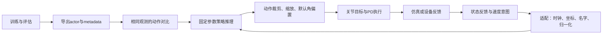

**配对代码：** [offline_policy_contract.py](../examples/lesson12/offline_policy_contract.py) → [AlienGo 训练配置](../references/legubiao_legged_gym/legged_gym/envs/unitree/aliengo/aliengo_config.py) 与 [训练环境](../references/legubiao_legged_gym/legged_gym/envs/base/legged_robot.py)。

# 第12课：RL策略怎样经过ROS 1与PD——先完成离线契约验收

[上一课：四足训练任务与参考环境](lesson_11_zh.md) · [课程目录](course_index_zh.md) · [学习路线](learning_path_zh.md)

建议分两次学习，每次45～60分钟。前置是第3课的PD、第6课的坐标与时钟、第8课的SDK边界，以及第9～11课的强化学习概念。目标是解释“训练出的网络怎样变成关节目标”，并用能手算的数据检查部署接口。

ROS 1 主线当前使用 Guide 算法控制 Gazebo 中的 AlienGo。[策略推理预览](rl_policy_preview_zh.md) 已读取仿真反馈并输出模型动作，但不控制关节；策略闭环尚未稳定。

本课提供标准库离线程序、明确的假动作fixture和接口测试。它不加载策略，不执行神经网络，不发布ROS控制，也不调用SDK或访问机器人网络。实验通过表示这些教学数据满足接口规则；策略闭环行走、Sim2Sim与真机尚需独立验证。离线记录见 [deployment-report.md](reports/rl-deployment.md)。

## 1. 训练、导出、推理各做什么

训练时，策略根据观测提出动作；仿真执行动作并给出奖励，优化器再更新网络参数。训练可能同时维护actor（策略）和critic（价值估计）。它通常需要大量并行回合，工作量远大于一次前向计算。

导出时，把选定checkpoint中的部署策略整理成目标运行时能加载的模型，并保存配套的输入输出约定。导出完成后，应拿同一批观测，比较训练端actor与导出模型的动作误差；还要比较归一化、history与reset后首帧。只验证文件存在，不能证明导出正确。

推理时，参数通常固定：输入一帧观测，得到一个动作，不根据这一步奖励更新权重。PPO训练中的随机采样和评估时的确定性动作也要明确选择。部署通常不需要critic；如果critic在训练时使用了真实基座速度、接触力或随机化参数等额外信息，不能把它的输入当作actor部署输入。actor若依赖历史编码器、循环网络状态或单独的归一化器，这些也属于部署包。

一种可选导出格式是 TorchScript；当前 ROS 1 控制链没有加载器。导出格式与加载器必须配套；把另一种导出文件改名为 `.pt` 不会改变格式。新项目选择格式时，应查所用版本的导出与运行时文档；[PyTorch官方torch.export说明](https://docs.pytorch.org/docs/stable/export)介绍的是另一套导出接口，本课没有安装或迁移运行时。



## 2. 观测是带语义的有序数组

本课采用常见的**45维教学actor观测**，没有body linear velocity。约定机身坐标为x向前、y向左、z向上，世界z向上；输入姿态表示机身到世界的旋转。

| Python切片 | 内容 | 原始单位与处理 |
|---|---|---|
| `[0:3]` | 机身角速度 `body_omega` | rad/s，乘0.25 |
| `[3:6]` | 机身坐标中的重力方向 | 无量纲，`Rᵀ·[0,0,-1]` |
| `[6:9]` | 速度意图 `[vx,vy,yaw_rate]` | m/s、m/s、rad/s，分别乘 `[2,2,0.25]` |
| `[9:21]` | `q-q_default` | rad，乘1 |
| `[21:33]` | `dq` | rad/s，乘0.05 |
| `[33:45]` | 上一次策略更新采用的裁剪后动作 | 12个无量纲值，reset后为0 |

上述缩放把不同量纲的数值调整到训练约定的范围；**本课系数只是教学数据**。实际模型可能使用不同系数，或使用训练中保存的均值/方差。拼接后，本课逐项裁剪到 `[-10,10]`。裁剪前先拒绝NaN、Inf和算术溢出，不能让裁剪掩盖坏数据。

第11课作者训练参考的 `aliengo_flat` 为**48维**，其中包含3维 `lin_vel`；本课45维实验不能直接输入该模型。`aliengo` 粗糙地形任务则继承235维配置，其中187维是高度采样；也不能把这两种训练任务的策略互换。两个模型即使都写48维，也可能有不同顺序、坐标方向、速度来源、缩放、默认姿态或历史步数；维数一致只说明长度一致。

查看 [metadata.json](../examples/lesson12/metadata.json)。它把关节名、观测顺序、xyzw、缩放、history与时间参数放在同一处。程序只支持其中声明的教学语义，遇到48维或wxyz配置会拒绝；修改配置标签并不能完成模型适配。实际部署包还应锁定模型/训练代码/URDF的版本与hash、dtype和batch形状、动作语义、归一化统计、PD参数与推理运行时。

## 3. 重力方向不是加速度计读数

本课 `orientation_xyzw=[x,y,z,w]`，单位姿态为 `[0,0,0,1]`。对有限、范数至少为 `1e-12` 的输入先归一化；零四元数或无法得到有限范数的输入整帧拒绝。实际驱动若严重偏离单位范数，是否允许归一化还应另设质量标准。ROS 的消息使用命名的 x、y、z、w 字段。

重力观测回答的是“朝下的方向在机身坐标里是什么”，这里使用长度为1的向量。它既不是世界中的 `-9.81 m/s²`，也不是静止IMU通常测到的朝上比力。回看第6课，再预测：

- 单位姿态时，应得到 `[0,0,-1]`。
- 绕y轴正向旋转90°，即xyzw为 `[0,√0.5,0,√0.5]`，应得到 `[1,0,0]`。
- 把四元数所有分量乘2，再归一化，应得到相同方向。

自动测试包含这组手算数据。SDK v3.3.1的IMU数组使用wxyz，转换时必须按字段重排；不要因为两边都有四个数就直接复制。

## 4. 动作怎样成为PD目标

本课假动作按每条腿重复 `[2,-2,0.5]`。程序按如下顺序处理：

```text
a_used = clip(a_fixture, -1, 1)
q_des = q_default + 0.25 * a_used
```

每条腿的教学默认角为 `[0,0.8,-1.5] rad`，所以输出是 `[0.25,0.55,-1.375] rad`。其中 `a_used` 是无量纲关节角残差，缩放系数是rad；不是绝对角度，也不是力矩。当前观测放入上一轮动作，再计算这一轮动作，不能把刚算出的动作倒填到其输入里。

进入真实执行层后，位置PD的一种形式为：

```text
tau = Kp * (q_des - q) + Kd * (dq_des - dq) + tau_feedforward
```

策略可以慢一些更新 `q_des`，PD持续用新反馈计算误差。设置 `dq_des=0`、前馈力矩为0是一种具体接口选择，需要与训练端一致。Kp/Kd、实际力矩限幅、目标变化速度、机械限位和驱动模式仍需验证；动作落在 `[-1,1]` 里并不保证电机行为合理。本课只输出含 `q_des` 的检查记录，未计算或发送PD力矩。

本课默认输出的12关节顺序与第8课的教学索引表一致：

| 索引 | 关节 |
|---|---|
| 0、1、2 | FR_hip_joint、FR_thigh_joint、FR_calf_joint |
| 3、4、5 | FL_hip_joint、FL_thigh_joint、FL_calf_joint |
| 6、7、8 | RR_hip_joint、RR_thigh_joint、RR_calf_joint |
| 9、10、11 | RL_hip_joint、RL_thigh_joint、RL_calf_joint |

输入列表可以打乱；程序先按名字建立映射，再按metadata中的顺序构造观测和输出。真实模型的训练顺序可能不同，动作也必须按名字映射到执行接口。`default_q` 与动作下标必须跟随模型关节顺序一起重排。

## 5. 实验一：检查可以手算的正常输出

在项目根目录执行：

```bash
cd /home/jack/aliengo_learning
./scripts/ros1_course.sh offline lesson12/offline_policy_contract.py \
  --metadata examples/lesson12/metadata.json --case valid
```

应看到 `accepted: true`、`source: explicit_action_fixture_no_model`、45个 `observation` 数值、135个 `history` 数值和12条 `targets`。第一帧观测前9项为：

```text
[0.5, -1.0, 0.25, 0.0, -0.0, -1.0, 1.0, -0.5, 0.5]
```

`-0.0` 与 `0.0` 数值相等。第一条目标是 `FR_hip_joint`、`q_des=0.25`；第二条为 `FR_thigh_joint`、`q_des=0.55`。这是明示fixture经过公式的结果，没有学习能力。

再运行打乱顺序的案例，确认目标身份不变：

```bash
./scripts/ros1_course.sh offline lesson12/offline_policy_contract.py --case shuffled
./scripts/ros1_course.sh offline lesson12/offline_policy_contract.py \
  --input examples/lesson12/fixture.json --now 10.0
```

[fixture.json](../examples/lesson12/fixture.json) 明确包含 `frame` 与 `action_fixture`。输入帧有 `stamp`、`body_omega`、`orientation_xyzw`、`command`、12条name/q/dq记录。`--input`每次启动一个新对象，只适合单帧检查；连续的时间、历史与动作行为由 `--demo` 和测试检查。`--output` 保存的是结果，不能把它当成输入帧回读。

## 6. 实验二：时间、history与decimation

示例metadata设 `pd_dt=0.002 s`、`decimation=10`、`policy_dt=0.02 s`，即理想PD反馈500Hz、策略50Hz。**这是本课频率示例，不是主仓运行测量，也不是AlienGo推荐参数。** 必须满足 `policy_dt=pd_dt×decimation`。

执行全部案例并保存JSON：

```bash
./scripts/ros1_course.sh offline lesson12/offline_policy_contract.py \
  --demo --output examples/lesson12/decisions.json
```

应看到 `demo_passed: true`，`policy_ticks: [0,10,20]`，`example_pd_hz: 500.0`、`example_policy_hz: 50.0`。这21个合成反馈时刻中，只有第0、10、20帧更新假动作和history，其余帧持有上次目标，但仍检查新反馈。程序不等待真实时间，因此没有测量推理耗时、控制抖动或达到实时性。

history按“最旧→最新”拼接3个45维观测，共135维；第一帧前90项用0填充。程序将history_steps限制为1～64、decimation限制为1～1000，防止教学JSON误填导致巨量缓存或极端计数；这不是硬件限制。这里的填充与上一动作语义必须与训练一致，不能拿它替代某个真实模型的history实现。`reset()`清除history、上一动作、计数器、已有目标与时间序列，允许明确的新回合或时钟重启。循环网络还需清除hidden state，本例没有循环网络。

**先预测：** 让第一轮fixture全为1，第二次策略更新的观测末12项应是什么？它们应为1，表示第一轮采用的动作。reset后则必须回到0；上个回合的记忆不能泄漏到新回合。

在未来的 ROS 1 推理设计中，需区分推理周期、关节控制器更新周期、通信周期和仿真物理步长。topic 发布频率不会自动保证控制周期；频率配置需要用实际测量的周期和超时次数验证。

## 7. 实验三：整帧拒绝与显式reset

合成帧的 `stamp` 与 `now` 必须来自同一条时间线；本例单个stamp代表已经同步好的完整快照。真实ROS适配层应分别核对关节、IMU和运动意图的时间及彼此偏差，不能给陈旧数据盖上新stamp冒充同步。仿真 `/clock` 暂停/重置、主机单调时钟、设备tick需分别处理，不能直接相减。

| 输入或事件 | 本课明确行为 |
|---|---|
| 年龄大于0.05s，或stamp晚于now | 整帧拒绝；本例不允许未来容差 |
| 与上一接受帧stamp重复或倒退 | 整帧拒绝 |
| 相邻stamp间隔偏离0.002s超过0.0005s | 整帧拒绝；这是理想反馈契约，真实抖动阈值需另定 |
| 缺关节、重复名、未知名、缺字段、数组长度错误 | 整帧拒绝 |
| 数据、时间或动作含NaN/Inf、布尔值、数字字符串 | 整帧拒绝；不自动转型补值 |
| 零/无效四元数，或计算结果溢出 | 整帧拒绝 |
| 任意帧被拒绝 | 进入 `DEGRADED`，输出 `targets: []`，后续好帧仍拒绝 |
| 显式调用 `reset()` | 回到 `WAITING`；清空历史后重新接收序列 |

单个拒绝案例返回退出码1；整组 `--demo` 在正常案例通过、坏案例全部被拒绝时返回0；参数/文件/metadata错误返回2。以下命令实跑应打印 `rejection exit=1`：

```bash
if ./scripts/ros1_course.sh offline lesson12/offline_policy_contract.py --case stale; then
  echo 'unexpected acceptance'
else
  echo "rejection exit=$?"
fi
```

还可把 `stale` 换成 `future`、`missing`、`duplicate_joint`、`nan`、`zero_quaternion`、`duplicate_stamp`、`backwards_stamp`、`bad_dt`、`bad_action`。测试命令为：

```bash
python3 -m unittest discover -s tests -p 'test_lesson12.py' -v
```

离线对象的 `DEGRADED` 只表示拒绝生成有效记录，**没有定义真实电机应该执行什么**。在真实系统中，应先设计并验证以下状态，而不是遇错后继续无限保持一个旧目标：

| 阶段 | 要核对的条件与转移 |
|---|---|
| WAITING / WARMUP | 收齐有效反馈；检查模型与metadata；预热运行时，结果不交给执行器；按训练约定初始化history/hidden state |
| READY | 在允许姿态与执行模式下取得控制权；目标连续性与设备退出方案已有证据 |
| ACTIVE | 每轮检查快照年龄、推理deadline、有限动作与目标变化；只接收属于当前序列的新结果 |
| DEGRADED | 记录原因，拒绝迟到结果；按预先验证的设备方案降级，例如短时受限保持后转支撑姿态或释放控制权 |
| RESET / STOPPED | 明确停止策略与执行层的责任；人工或上层确认恢复条件，清空记忆后重新进入WARMUP |

这是后续集成设计表，本课只实现WAITING/ACTIVE/DEGRADED的离线入口。deadline是“结果最晚可被采用的时刻”，不能只看平均耗时。应测冷启动、稳态与负载下的耗时分布、最大反馈年龄、漏周期、端到端延迟，并为超时决定结果作废与降级规则。预热不能证明此后永不超时；ROS控制器生命周期退出也不自动等于电机停止。

## 8. 对照训练源码与 ROS 1 控制链

阅读[训练环境](../references/legubiao_legged_gym/legged_gym/envs/base/legged_robot.py) 的观测与动作处理，以及 [AlienGo 训练配置](../references/legubiao_legged_gym/legged_gym/envs/unitree/aliengo/aliengo_config.py) 的默认姿态、增益和缩放。ROS 1 的 Guide 与关节接口见 [IOROS.cpp](../references/unitree_guide/unitree_guide/src/interface/IOROS.cpp) 和 [joint_controller.cpp](../references/unitree_ros/unitree_legged_control/src/joint_controller.cpp)。

当前只读预览使用公开的 UniO4-Aliengo 候选权重，来源和固定哈希见 [策略预览说明](rl_policy_preview_zh.md)；它尚不控制关节。后续闭环适配器需显式检查训练与推理的观测顺序、坐标、速度来源、关节顺序、动作、时钟、默认姿态及 PD 参数；不能只按文件后缀或维度加载。

## 9. 从Sim2Sim到真机，还缺什么证据

Sim2Sim是把训练策略放进另一套物理/执行接口里评估，例如从训练环境进入现有Gazebo链。先固定checkpoint、metadata、URDF、初态、命令序列、随机种子与执行参数，然后分别评估零命令站立、低速直行、转弯、速度阶跃和扰动；从最简单场景逐步增加难度。

记录可比较的量：摔倒率/存活时长、速度跟踪RMSE、roll/pitch、关节限位/力矩饱和次数、动作变化率，以及反馈延迟和deadline违约次数。改变摩擦、质量、控制延迟、传感器噪声后再比较分布。出现差异时，先用相同观测fixture排查接口，再定位接触模型、执行器和状态估计差别；提高奖励并不能修复关节排列错误。本课没有完成这些物理评估。

Sim2Real还需要第8课未解决的设备证据：实际型号/固件支持的接口和模式切换、SDK版本、关节名与槽位、方向与零点、单位与校准、反馈时钟、通信超时与退出行为，以及设备允许的限位/力矩/温度范围。第8课固定的 `unitree_legged_sdk v3.3.1` 是参考接口；这里没有以SDK2控制AlienGo，也没有把某个Go2示例当作可直接运行的AlienGo程序。

把下一阶段按结果推进：先完成导出前后动作对比与完整契约核对，再完成Sim2Sim定量报告，之后依据设备文档设计分步真机测试。没有实际固件与执行行为证据时，课程进度应停留在离线准备与仿真验证的对应层级。

## 10. 验收问题与参考讲评

1. 本课45维为什么不能直接喂给源码中的48维策略？如果把数组补到48维，是否足以证明兼容？actor和critic的输入又为什么可能不同？
2. 假动作 `[2,-2,0.5]` 如何得到一条腿的目标角？为什么当前观测用上一轮动作，reset后又必须清history？
3. 运行重复时间戳、NaN和过期案例，解释为何返回空targets；为什么 `demo_passed=true`、500/50Hz配置和状态名 `DEGRADED` 还不能证明真机可运行？

<details>
<summary>先完成实验，再展开参考讲评</summary>

1. 该源码配置包含额外的机身线速度，顺序也不同。补三个数字只改变长度，未确认速度估计、坐标系、缩放、关节顺序、默认角和history。critic可在训练时使用部署时不可获得的额外状态；应导出并复现actor真正依赖的输入及记忆。
2. 先clip为 `[1,-1,0.5]`，乘0.25rad，再加 `[0,0.8,-1.5]`，得到 `[0.25,0.55,-1.375] rad`。上次动作帮助策略理解已经施加的控制；本次输出不能提前成为其输入。新回合、控制重入或时钟重置需按训练约定清掉历史与循环状态，防止旧回合污染。
3. 重复stamp不能算新的反馈，NaN不能用于可靠计算，过期帧已失去时效；整帧拒绝避免部分关节混入有效结果。本例随后锁定，必须reset。demo只检查fixture契约，频率是合成时间线，DEGRADED只控制离线记录；模型数值、实时deadline、物理闭环、设备模式与退出响应都还需独立证据。

</details>

[回看第8课SDK离线验收](lesson_08_zh.md) · [回到课程目录](course_index_zh.md) · [回到学习进度](learning_progress_zh.md)
