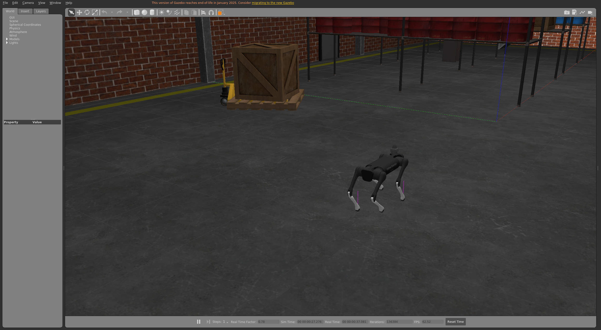
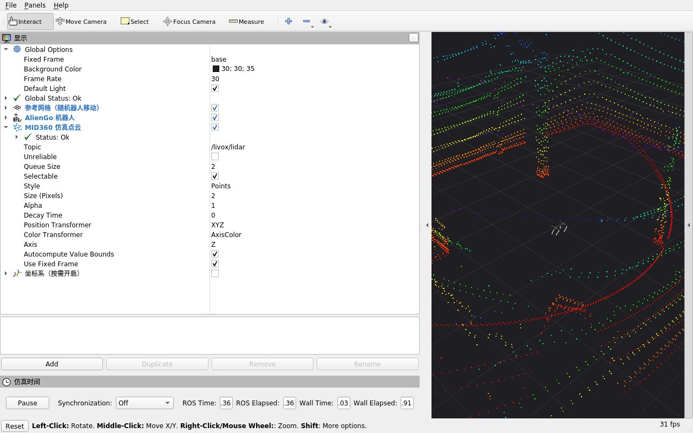

# Depot 仓库适配与验证

用户指定 [livox_gz_sim 的 hap_fastlio.webp](https://github.com/mathaimp/livox_gz_sim/blob/main/docs/hap_fastlio.webp) 所示仓库。实际资产是 OpenRobotics Fuel Depot v6，保留 ROS1 Noetic、Gazebo Classic 11、AlienGo、MID360 和 NVIDIA GPU 渲染。

本页记录初版场景与灯光验证，当时 RViz 使用机身固定系。后续已补上动态 Gazebo 真值 world→base，并改用 world 固定系，详见 [RViz 运动同步修复](rviz-world-motion.md)。

## 修复内容

- 固定约 78 MiB ZIP 资源并验证 SHA256、ZIP CRC；来源和 CC-BY-4.0 署名见 [depot_source.json](../../ros1/worlds/depot_source.json)。原始 model.sdf SHA256 为 `11ad26026c49db0b73be882d3f61c3ab5fc637ca736a657d20b516b14b951afe`，未修改。
- 保留原 0.6 网格比例与布局，仓库外墙约 30.6×15.6m；采用 (-5,0,0.6)、yaw=0 的底层出生点，距最近柱子约 4.10m。
- 16 个原始 visual 各有一个对应 collision，保留 submesh、center、scale 和 pose。完整 FLOOR 包含底层与约 2m 高夹层；移除重叠的旧 plane。可承重地面随实际 FLOOR 范围结束。
- 静态化模型、保留风扇初始位置，移除现代 Gazebo 风扇控制插件与关节。
- 移除 SDF 的 PBR/纯色覆盖，直接读取 DAE 材质和 UV。
- **大面积发白的主因**：原模型两盏 `fan_light` 的三项衰减均为 0。Classic 的 [光照 shader](https://github.com/gazebosim/gazebo-classic/blob/gazebo11/media/rtshaderlib/SGXLib_PerPixelLighting.glsl#L114) 计算 `1/(c+l*d+q*d²)`，因此分母恒为 0。原参数实测白化，改为 `.5/.01/.002` 后截图恢复正常；单独降低高光或移除材质覆盖未解决全局白化。
- RViz 使用官方 `DISABLE_ROS1_EOL_WARNINGS=1` 开关跳过阻塞式提示；不改 ROS 版本。

## 最终实测

实际执行 [键盘回归脚本](../../scripts/verification/ros1_keyboard_trial.sh)，唯一限资源容器运行 Gazebo GUI、RViz 和控制器，4 CPU / 4 GiB，无容器网络。向真实伪终端依次发送 2、4、w、w、空格。最终记录为 `logs/keyboard-trial-cufnpJ`；[完整结果](depot-validation.json)。

| 检查 | 结果 |
|---|---|
| 结果 | PASS |
| 连续前进 | 30.002 仿真秒 / 38.27 墙钟秒 |
| 前进位移 | 1.440 m |
| 行走最大横滚 / 俯仰 | 0.439° / 0.185° |
| 空格后 5 秒漂移 | 2.06 mm |
| 实时因子 | 0.784 |
| 雷达 / IMU | 9.999 / 199.884 Hz，按仿真时间 |
| 一帧有效 XYZ 点 | 6000 |
| 雷达坐标 z>1m 的点 | 4420，确实命中墙/高处几何 |
| RViz | 节点 `/mid360_rviz` 存活且订阅 `/livox/lidar`，画面 Status OK |
| 暂停时退出控制器 | 0.264 秒 |
| GPU | NVIDIA GeForce RTX 5060 Laptop GPU/PCIe/SSE2 |
| 运行中单次资源采样 | 约 1.424 GiB 内存 / 367% CPU；并非峰值监控 |

147 项现有单测、相关 Python 语法和 shell 语法检查通过。独立静态审查确认完整碰撞、路径、许可与文档一致。

## 验证范围

首轮 GUI 初始化出现过黑屏并停在约 0.09s，已中止；此前一次无界面站立也未通过。后续 GUI 行走和最终完整地板、修正灯光后的 30s 回归通过，不能把这些早期失败记录当作成功。新配置还经过正常交互入口重新启动与截图确认。

本次场景测试证明仓库底层开阔通道低速行走、停车及实时点云，不证明爬梯、夹层行走、碰撞恢复、SLAM、FAST-LIO 或 GBPlanner 已完成。夹层几何已进入碰撞世界，但控制器未针对其坡面和楼梯验证。本次历史测试中 RViz 使用 base 固定坐标系；后续 world 固定系与动态真值 TF 见本页顶部的运动同步修复记录。
