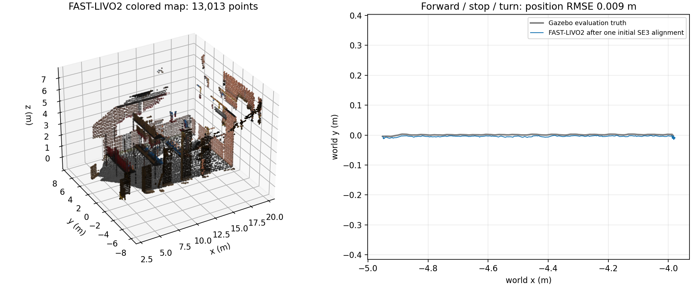

# FAST-LIVO2 接入验证（2026-11-16）

FAST-LIVO2 已在独立工作区编译，并通过 Depot 仓库在线融合与传感器独立回放试验。原有仿真入口、机器人与传感器模型、Super-LIO 和 GBPlanner 工作区保持原有用途；新算法使用单独的 `fast_livo_sim.sh`、`fast_livo_start.sh`。

## 在线试验

命令：`./scripts/verification/fast_livo_trial.sh --seconds 20 --record-bag`。

原始日志：`logs/fast-livo-trial-3ZskKm/`。结果 [JSON](fast-livo2-online.json)，**PASS**，全部 22 项检查通过。

| 指标 | 结果 |
| --- | --- |
| 试验 | 站立初始化、零速小跑、20 秒前进、停车、8 秒转向、停车 |
| 真值前进距离 | 0.9591 m |
| 估计前进距离 | 0.9553 m |
| 轨迹位置 RMSE | 0.008995 m |
| 最大位置误差 | 0.01446 m |
| 转向真值 | 0.38937 rad |
| 转向变化误差 | 0.000297 rad |
| 时间匹配覆盖 | 383 / 383 轨迹样本 |
| 实际视觉特征更新 | 386 帧有特征，最多 190 点 |
| 融合里程计 | 387 条；387 条时间戳匹配原图像 |
| 最终有效输入到估计的滞后 | 0.0724 s |
| 原始彩色地图 | 213,723 点 |
| 0.15 m 降采样地图 | 13,013 点 |
| 墙钟用时 | 87.2 s |

误差使用一次初始 SE3 对齐，以及按估计时间戳插值的 Gazebo 真值计算；真值不进入估计器。ROS 图确认估计器只订阅图像、LiDAR、IMU 和 `/clock`。检查了位姿有限值、严格递增时间戳、同时间戳 base TF、RGB 数据非零、持续更新和退出保存，所有进程按预期退出。

实际运行时标定为 640×360，fx=fy=465.601475318367，cx=320、cy=180；LiDAR→IMU 平移为 (-0.011,-0.02329,0.04412)，LiDAR→相机光学系平移为 (0.015,-0.133,-0.07)，完整旋转矩阵在 JSON 的 `calibration` 字段。标定只来自 CameraInfo 和静态安装 TF。

可下载 [降采样彩色地图](fast-livo2-map.pcd)。仅为本次短距离轨迹所见的相机视野范围，不代表完整仓库覆盖。

## 独立回放

命令：`./scripts/verification/fast_livo_replay.sh logs/fast-livo-trial-3ZskKm/sensors.bag`。

日志：`logs/fast-livo-replay-fzMGd2/`。结果 [JSON](fast-livo2-replay.json)，**PASS**，全部 11 项检查通过。

在无 Gazebo、无真值接口的独立容器中，以 0.5 倍速重放 RGB、CameraInfo、LiDAR、IMU 和静态 TF，由播放器生成 `/clock`。共输出 410 条融合里程计，409 帧有视觉特征，最多 212 点；退出保存 226,674 个原始彩色点、13,003 个降采样点。最终估计距可用输入末尾 0.0646 秒，所有传感器距回放时钟末尾不超过 0.0737 秒，墙钟用时 92.2 秒。

回放检查同时约束连续输出和所有输入流末尾覆盖，不能仅凭开始几帧有输出就通过。在线与回放的启动订阅时刻不同，因此帧数和地图点数不要求完全一致。

## 构建与回归

- 官方 FAST-LIVO2 固定提交 `0d2c0346107b75b59934975adec9a6eeeb913c64`，完整依赖版本见 `ros1/fast_livo/source.json`。
- Docker 主程序构建及审查修复后的增量构建均退出 0；资源上限 4 GiB、2 CPU，`-j1`、O2。
- 主机测试：`OMP_NUM_THREADS=1 OPENBLAS_NUM_THREADS=1 MKL_NUM_THREADS=1 python3 -m pytest tests -q` → **217 passed, 42 skipped**。跳过项需要相应 ROS/其他可选环境。
- 新增融合进度检查另在 Noetic 中执行：**3 passed**，包括输入继续而估计停止、相机中断和正常一帧延迟。
- 实际 ROS 标定测试覆盖 CameraInfo/图像、静态 TF、命名空间与可执行程序交接。
- `fast_livo_snapshot_test.sh`：真实 C++ XYZ 过滤、零偏移及不同时间快照刚体补偿检查通过。
- `fast_livo_overflow_test.sh`：实际 ROS 节点在相机缺失、IMU 正常、LiDAR 队列满时明确报错退出，避免永久等待；旧二进制复现失败，修复后通过。
- 独立启动入口测试确认普通仿真仍使用原镜像、不会挂载 FAST-LIVO2 或关闭真值显示；新入口单独挂载新工作区并拒绝禁用相机。

构建、测试控制台记录保存在 `logs/fast-livo-integration/`。上游参考源码保持 clean，补丁只作用于 `.fast_livo/src`。独立代码审查发现并修复了缓冲区满时的永久等待和验证器只检查累计输出的问题。

## 边界

这是特定仓库、低速短距离、理想仿真传感器下的结果。没有验证实机外参、硬件时间同步、长距离漂移、闭环、GBPlanner 接入或真实电机控制。FAST-LIVO2 仍会为异步图像进行整帧点云的时间对齐；仿真并不包含真实 MID-360 的逐点扫描畸变。当前只在有新激光点的视觉帧上发布融合结果，可能多等待一帧 LiDAR。

## RViz 状态与中文字体复查（同日）

针对“走动后报错”和中文显示为方框的问题，增加一次运行中的 RViz 属性树记录。试验目录 `logs/fast-livo-trial-HAkgkl/`，诊断脚本和汇总在 `logs/fast-livo-rviz-investigation/`。

- 完成 40 秒前进约 1.915 m、停车、8 秒转向和停车；原有在线检查 PASS，轨迹 RMSE 0.01063 m。
- 记录 235 次 RViz 状态：启动后的前 4 次为 `Unknown frame livo_map`，最后一次发生在 RViz 初始化后约 2.10 秒；随后 231 次全局状态均为 Ok。
- 运动期间机器人、彩色地图、RGB、跟踪图像和轨迹状态均为 Ok。此次未复现用户报告的运动后错误，不能据此认定原问题已经解决。
- 用户此前保存的独立运行轨迹在末段出现较大姿态变化；该运行没有保留传感器包或同步真值，无法确定变化来自真实仿真运动还是估计异常。
- 字体问题已确认并修复：旧专用镜像没有中文字体，Qt 的中文字形检查失败。专用 Dockerfile 增加 `fonts-noto-cjk` 和字体缓存，镜像已重建；“显示地图图像轨迹估计坐标彩色视觉跟踪”全部字形检查通过，实际 Qt 渲染已目视确认。
- 专用启动脚本现将算法与 RViz 的 ROS 日志保存到 `.fast_livo/logs/日期时间-PID/`，容器关闭后仍可读取。现有普通仿真入口和机器人控制逻辑不作改动。
- 相关启动回归检查 7 项通过，启动脚本语法检查通过。字体修复只需重启专用仿真，不需要重编译算法。
