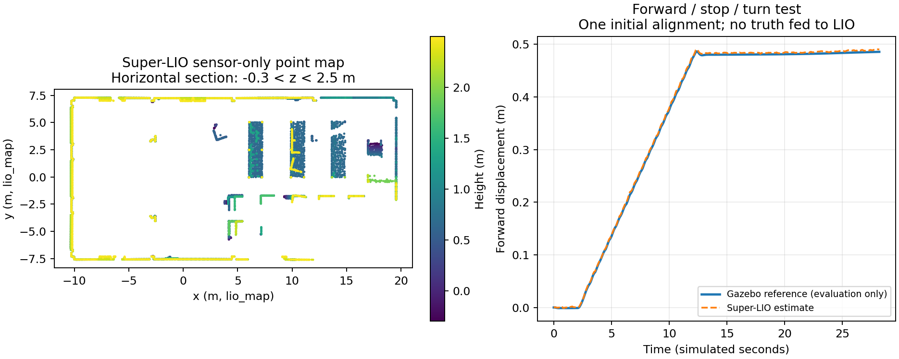

# Super-LIO ROS1 接入验证

已接入 [Super-LIO 官方 ROS1 分支](https://github.com/Liansheng-Wang/Super-LIO/tree/ros1)，固定提交 `60b57aaac8dc397f80c56364e7ccb008c300cc29`。官方已有 MID360 CustomMsg 支持；本次补齐当前仿真的 XYZ 快照输入、估计 TF 与运行入口。

## 验证结果

最终在线记录：`logs/super-lio-trial-jhTmcX`，[完整 JSON](super-lio-online.json)。同一 4CPU / 4GiB 容器中运行 Gazebo、键盘、Super-LIO 和 NVIDIA RViz，真实按键完成站立、前进、停车、转向及关闭。

| 检查 | 结果 |
|---|---|
| 最终在线结果 | PASS |
| 前进 | 真值 0.476558m / 估计 0.476811m |
| 本段前进位移差 | 0.254mm |
| 一次初始SE3对齐后全轨迹RMSE | 4.641mm |
| 最大位置差 | 7.662mm |
| 转向 | 真值 22.423° / 估计 22.425° |
| 轨迹样本覆盖 | 283/283 |
| 输出 | 286帧估计位姿，285帧非空配准点云 |
| 估计TF | 在估计原时间戳可查询 lio_map→base |
| RViz | 实际固定系 lio_map，订阅 /lio/cloud_world |
| 渲染 | NVIDIA GeForce RTX 5060 Laptop GPU |
| 退出 | LIO、控制器、仿真均正常返回0，地图保存完成 |

真值只在评估端做**一次**初始刚体对齐，随后比较误差，没有逐帧校正估计。运行图确认 Super-LIO 仅订阅 `/clock`、`/livox/lidar`、`/livox/imu`。关闭了原 Gazebo 真值 TF；地图与机器人显示来自算法估计。

图左是独立重放所保存点云地图的水平截面，图右是最终在线试验的位移对照。

## 无 Gazebo 的传感器独立重放

使用 `logs/super-lio-trial-OX3a7b/sensors.bag`，包中仅含 `/clock`、XYZ点云和IMU。新建无网络容器，**没有启动 Gazebo、没有挂载控制工作区、没有真值或TF输入**，只重放两个传感器话题并生成时钟。

重放记录：`logs/super-lio-replay-fBFnOx`，[完整 JSON](super-lio-replay.json)。结果 **PASS**，输入覆盖 41.32 仿真秒，输出 406 帧估计位姿、405 帧非空配准点云，估计最大平面位移 0.973m，保存 **60455 点**的 [PCD地图](super-lio-map.pcd)。回放和算法均返回0。

这证明估计器能够只根据传感器数据运行。它不等同于实机精度验证，也不证明闭环或 GBPlanner 已完成。

## 本地兼容改动

- 原参考源码 `references/Super-LIO` 未修改。运行副本 `.super_lio/src` 应用 [快照补丁](../../ros1/patches/super_lio_snapshot.patch) 与 [空地图取消补丁](../../ros1/patches/super_lio_cancel_empty_map.patch)。源码、许可与镜像记录见 [source.json](../../ros1/super_lio/source.json) 和 [repositories.lock.json](../../repositories.lock.json)。
- `SIM_SNAPSHOT=8`直接接收 XYZ。原stamp保留，全部点时间偏移为0；保留原IMU传播和滤波、匹配、地图更新，快照仅做雷达到IMU外参变换。
- 官方MID360模式1保留；没有把快照伪装成具有0～100ms逐点时间的硬件扫描。
- IMU为 m/s²、rad/s，`gravity_norm=9.81`；先站稳再取前50个样本初始化。
- 所有估计输出的父系改为 `lio_map`。IMU位姿经 `T_LB=T_LI·inverse(T_BI)` 转为base；安装外参来自URDF静态链。
- 两工作区运行时用 `source /lio/devel/setup.bash --extend` 保留控制包环境；普通ROS1入口原默认行为保持。
- 构建O2、无LTO、单任务3GiB；TBB限2线程。GPU只用于渲染，Super-LIO估计、ODE与当前射线检测仍用CPU。

## 失败记录与边界

首轮 `PYlMIN` 在新增外层物理锁后采样停滞，尚未进入算法，记录为FAIL；已恢复Gazebo上游的锁范围，仅在射线Update返回后共用一次仿真时间戳，后续在线和离线均正常。没有对未捕获的具体线程等待环作推断。

`OX3a7b` 的20秒前进、转向、误差、地图和bag检查全部通过，但旧验证器只给Gazebo退出5秒，早于roslaunch默认15秒SIGINT流程，整体保留为FAIL。已显式使用5秒SIGINT/2秒SIGTERM流程，并给收尾12秒预算；最终 `jhTmcX` 全部通过。没有把旧FAIL改成PASS。

宿主运行158项测试：151项通过、7项因宿主无ROS跳过；这7项已在Noetic容器中实际运行通过。早期取消无地图、文件与脚本语法、从原始源码重新应用补丁也验证通过。

本结果限定为零噪声、批量瞬时扫描、底层开阔通道与低速运动。未模拟真实逐点去畸变、噪声或反射率。运行算法不改控制器，不向真实硬件发送命令。所有测试结束后，仿真、RViz、控制器及LIO进程均已关闭。

使用步骤见 [Super-LIO说明](../super_lio_zh.md)。
